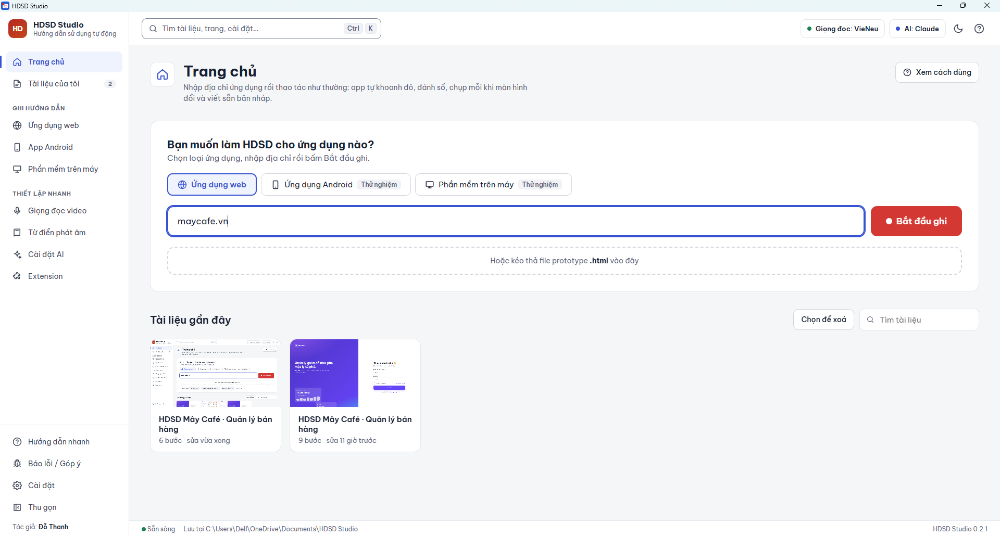

  <!-- Đổi đường dẫn ảnh sau khi bạn tải ảnh chụp màn hình lên repo, ví dụ docs/man-hinh-chinh.png -->
  

<h1 align="center">HDSD Studio</h1>

  <b>Thao tác một lần, có ngay tài liệu và video hướng dẫn.</b> 
  App tự ghi lại từng cú bấm, AI viết lời cho từng bước, rồi tự dựng video có giọng đọc tiếng Việt và nhạc nền.

  <a href="../../releases/latest"><b>⬇️ Tải bản mới nhất</b></a>

---

## Tải về và cài đặt

Vào trang **[Releases](../../releases/latest)**, ở mục **Assets** chọn đúng file cho máy của bạn:

| Máy | File cần tải |
|---|---|
| Windows 10 / 11 (64-bit) | `HDSD-Studio-Setup-x.y.z.exe` |
| macOS chip Apple (M1, M2, M3, M4…) | `HDSD-Studio-x.y.z-arm64.dmg` |
| macOS chip Intel | `HDSD-Studio-x.y.z-x64.dmg` |

> Không biết Mac của mình chip gì? Bấm biểu tượng  › **Giới thiệu về máy Mac này**, xem dòng **Chip** hoặc **Bộ xử lý**.

Các file `.blockmap`, `.yml`, `.zip` là để app tự cập nhật, bạn **không cần tải**.

### Windows

1. Mở file `.exe` vừa tải.
2. Nếu Windows hiện **"Windows đã bảo vệ PC của bạn"**, bấm **Thông tin bổ sung** › **Vẫn chạy**.
3. Chọn thư mục cài (hoặc để mặc định) rồi bấm **Cài đặt**. Biểu tượng HDSD Studio sẽ có trên màn hình chính.

### macOS

1. Mở file `.dmg`, kéo **HDSD Studio** vào thư mục **Applications**.
2. Lần đầu mở, nếu máy báo không mở được: vào **Cài đặt hệ thống › Quyền riêng tư & Bảo mật**, kéo xuống dưới và bấm **Vẫn mở**. Hoặc bấm chuột phải vào app › **Mở**.
3. Khi ghi phần mềm trên máy, macOS sẽ hỏi quyền **Ghi màn hình** và **Trợ năng**. Bạn bật cho HDSD Studio rồi mở lại app.

## App làm được gì

### 🎬 Tự động ghi lại thao tác
Bạn chỉ cần dùng phần mềm như bình thường. Bấm vào đâu, HDSD Studio khoanh đỏ và đánh số ở đó. Màn hình chuyển là app tự chụp. Không cần chụp tay, không cần cắt ghép ảnh.

- Ghi được **ứng dụng web**, **phần mềm cài trên máy** (Windows, macOS) và **ứng dụng trên điện thoại Android**.
- Trang dài phải cuộn vẫn ghi liền mạch trong cùng một bước.
- Ghi xong là có ngay bản nháp đầy đủ các bước.

### ✨ AI tự viết lại lời thoại và các bước
- Dựa trên các thao tác bạn vừa ghi, AI viết tên bước, câu mô tả, lời đọc cho video, gọn và dễ hiểu.
- Chưa ưng thì bấm viết lại, hoặc tự sửa từng câu.
- Dịch cả tài liệu sang ngôn ngữ khác, xem song song bản gốc và bản dịch.

### 🎥 Tự động tạo video hướng dẫn
Một cú bấm, app dựng thành video MP4 hoàn chỉnh, không cần phần mềm dựng phim.

- **Giọng đọc tiếng Việt tự nhiên**, ngắt nghỉ như người đọc. Dùng giọng có sẵn, chọn trong nhiều giọng miễn phí, hoặc **tạo giọng của chính bạn** từ một đoạn ghi âm ngắn.
- **Nhạc nền** có sẵn nhiều phong cách (nhẹ nhàng, tươi sáng, công nghệ…) hoặc dùng nhạc của bạn, chỉnh to nhỏ tuỳ ý. Nhạc tự nhỏ lại khi có lời đọc.
- **Phụ đề** tự động theo lời đọc.
- Nhiều kiểu video: phóng lần lượt tới từng chỗ cần bấm (khổ ngang hoặc dọc), mỗi bước một cảnh kèm danh sách thao tác, hoặc video giới thiệu sản phẩm.

### 📄 Xuất tài liệu
- Word (có mục lục bấm được), PDF, Markdown hoặc thư mục ảnh.
- Trước khi xuất có thể sửa câu chữ, kéo lại khung đỏ, vẽ thêm khung, làm mờ thông tin nhạy cảm, sắp xếp, tách, gộp các bước.

### 🔊 Về giọng đọc VieNeu
Muốn giọng tự nhiên nhất mà vẫn miễn phí: vào **Cài đặt › Giọng đọc video**, bấm **Tải giọng đọc VieNeu**. Tải một lần khoảng 1,3 GB, sau đó chạy ngay trên máy, không cần mạng, xoá được bất cứ lúc nào.

## Phím tắt khi ghi

| Phím | Việc |
|---|---|
| F2 | Chụp ngay màn hình hiện tại thành một bước |
| F3 | Bật / tắt đánh số (tắt khi chỉ muốn đi tới màn khác) |
| F4 | Xoá hết số trên màn hình hiện tại |
| F7 | Xoá bước vừa chụp |
| F8 | Bỏ số cuối cùng |
| F9 | Chụp sau 3 giây (cho menu chỉ hiện khi rê chuột) |

Trên MacBook có thể phải giữ phím `fn` khi bấm F2–F9. Bấm thẳng vào một số đỏ để xoá điểm đó, các số còn lại tự đánh lại.

## Cập nhật

App tự kiểm tra bản mới mỗi lần mở. Khi có bản mới, app tải về và hiện danh sách tính năng mới, lỗi đã sửa. Bạn bấm **Khởi động lại để cập nhật** là xong, tài liệu cũ vẫn giữ nguyên.

## Dữ liệu và quyền riêng tư

- Tài liệu lưu trên máy bạn, ở thư mục `Documents/HDSD Studio` (đổi được trong Cài đặt).
- App **không ghi lại những gì bạn gõ**, kể cả mật khẩu. Nhưng ảnh chụp có mọi thứ hiện trên màn hình, nên hãy dùng dữ liệu mẫu khi ghi.
- Khi app gặp lỗi, app gửi báo lỗi ẩn danh (không có tên, không có nội dung tài liệu) để tác giả sửa nhanh hơn. Bạn tắt được ở **Cài đặt › Chung › Tự gửi báo lỗi ẩn danh**.

## Báo lỗi và góp ý

Trong app, mở trang **Báo lỗi**, mô tả lỗi rồi bấm gửi.
