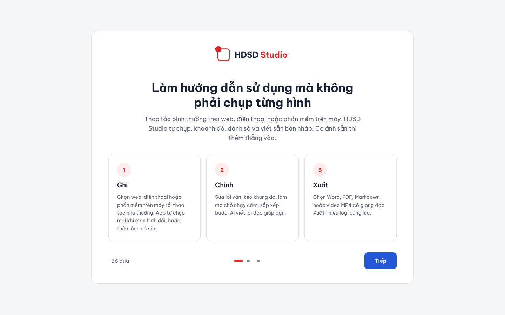
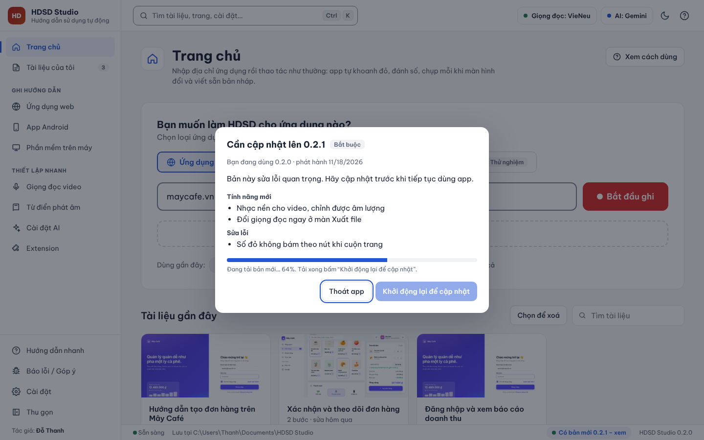

# 1. Cài đặt và cập nhật

[← Mục lục](README.md)

## 1.1. Cấu hình máy

| | Tối thiểu | Ghi chú |
|---|---|---|
| Hệ điều hành | Windows 10 hoặc 11 (64-bit), macOS chip Apple hoặc Intel | |
| RAM | 4 GB | Muốn dùng giọng đọc **VieNeu** cần từ **8 GB** |
| Ổ đĩa trống | 500 MB | Thêm khoảng **2 GB** nếu tải giọng VieNeu |
| Mạng | Cần khi tải app, tải giọng VieNeu, dùng AI | Ghi, biên tập, xuất file chạy không cần mạng |

## 1.2. Tải file cài

1. Mở trang **[Releases](https://github.com/thanhdv193/hdsd-studio/releases/latest)**.
2. Kéo xuống mục **Assets**, chọn đúng file cho máy của bạn:

| Máy của bạn | File cần tải |
|---|---|
| Windows | `HDSD-Studio-Setup-x.y.z.exe` |
| Mac chip Apple (M1, M2, M3, M4…) | `HDSD-Studio-x.y.z-arm64.dmg` |
| Mac chip Intel | `HDSD-Studio-x.y.z-x64.dmg` |

Các file `.blockmap`, `.yml`, `.zip` là để app tự cập nhật, bạn **không cần tải**.

> **Không biết Mac của mình chip gì?** Bấm biểu tượng  ở góc trên bên trái › **Giới thiệu về máy Mac này**. Dòng **Chip** ghi "Apple M…" là chip Apple, dòng **Bộ xử lý** ghi "Intel" là chip Intel.

## 1.3. Cài trên Windows

1. Mở file `HDSD-Studio-Setup-x.y.z.exe` vừa tải.
2. Nếu Windows hiện hộp xanh **"Windows đã bảo vệ PC của bạn"**: bấm chữ **Thông tin bổ sung**, rồi bấm **Vẫn chạy**. Đây là cảnh báo chung cho phần mềm mới, không phải lỗi.
3. Làm theo các bước của trình cài đặt. Bạn có thể đổi thư mục cài, để mặc định là được.
4. Cài xong, mở app bằng biểu tượng **HDSD Studio** trên màn hình chính hoặc trong menu Start.

## 1.4. Cài trên macOS

1. Mở file `.dmg` vừa tải.
2. Kéo biểu tượng **HDSD Studio** vào thư mục **Applications**.
3. Mở **Applications**, bấm đúp **HDSD Studio**.
4. Lần đầu mở, nếu máy báo **"không thể mở vì không xác minh được nhà phát triển"**:
   - Vào **Cài đặt hệ thống › Quyền riêng tư & Bảo mật**.
   - Kéo xuống dưới, thấy dòng nói về HDSD Studio, bấm **Vẫn mở**, nhập mật khẩu máy.
   - Hoặc: bấm **chuột phải** vào app trong Applications › **Mở** › **Mở**.
   - Nếu máy báo **"HDSD Studio bị hỏng và không thể mở được"**: bấm **Huỷ** (đừng chuyển vào Thùng rác), mở ứng dụng **Terminal**, dán dòng dưới rồi Enter, sau đó mở lại app:
     ```
     xattr -cr "/Applications/HDSD Studio.app"
     ```
5. Khi ghi phần mềm trên máy, macOS sẽ hỏi thêm quyền **Ghi màn hình** và **Trợ năng**. Xem [Ghi phần mềm trên máy](04-ghi-phan-mem.md#42-trên-macos-cấp-2-quyền-làm-1-lần).

## 1.5. Lần đầu mở app

App hiện **3 trang giới thiệu** ngắn: **Ghi**, **Chỉnh**, **Xuất**.



- Bấm **Tiếp** để xem trang sau, trang cuối bấm **Bắt đầu**.
- Bấm **Bỏ qua** để vào thẳng Trang chủ.
- Muốn xem lại: bấm **Hướng dẫn nhanh** ở thanh bên, nút **?** trên cùng, hoặc **Xem cách dùng** ở Trang chủ.

## 1.6. Cập nhật bản mới

App **tự kiểm tra bản mới mỗi lần mở**. Mọi bản cập nhật đều là **bản bắt buộc**: bạn cần cập nhật để tiếp tục dùng app, nhờ vậy ai cũng có bản đã sửa lỗi mới nhất.



**Trên Windows**
1. Khi có bản mới, hộp **"Cần cập nhật lên x.y.z"** hiện ra, ghi rõ bạn đang dùng bản nào, ngày phát hành, và danh sách **Tính năng mới**, **Sửa lỗi**.
2. App tự tải bản mới, thanh tiến độ chạy tới 100%.
3. Bấm **Khởi động lại để cập nhật**. App tắt, cài bản mới và tự mở lại.
4. Tài liệu, giọng đọc và cài đặt của bạn **được giữ nguyên**.

**Trên macOS**
1. Bấm **Tải bản mới (.dmg)**.
2. Mở file vừa tải, kéo HDSD Studio vào **Applications**, chọn **Thay thế**.
3. Mở lại app.

**Kiểm tra thủ công:** vào **Cài đặt › Chung › Cập nhật**, bấm **Kiểm tra cập nhật**. Bấm **Xem tất cả thay đổi trên trang phát hành** để xem lịch sử các bản.

Ở thanh trạng thái dưới cùng, khi có bản mới sẽ hiện chữ **"Có bản mới x.y.z – xem"**, bấm vào để mở hộp cập nhật.

## 1.7. Gỡ cài đặt

- **Windows**: **Cài đặt › Ứng dụng › Ứng dụng đã cài**, tìm **HDSD Studio**, bấm **Gỡ cài đặt**.
- **macOS**: kéo **HDSD Studio** trong Applications vào Thùng rác.

Gỡ app **không xoá tài liệu** của bạn trong thư mục `Documents/HDSD Studio`.

[Trang sau: Làm quen giao diện →](02-lam-quen.md)
