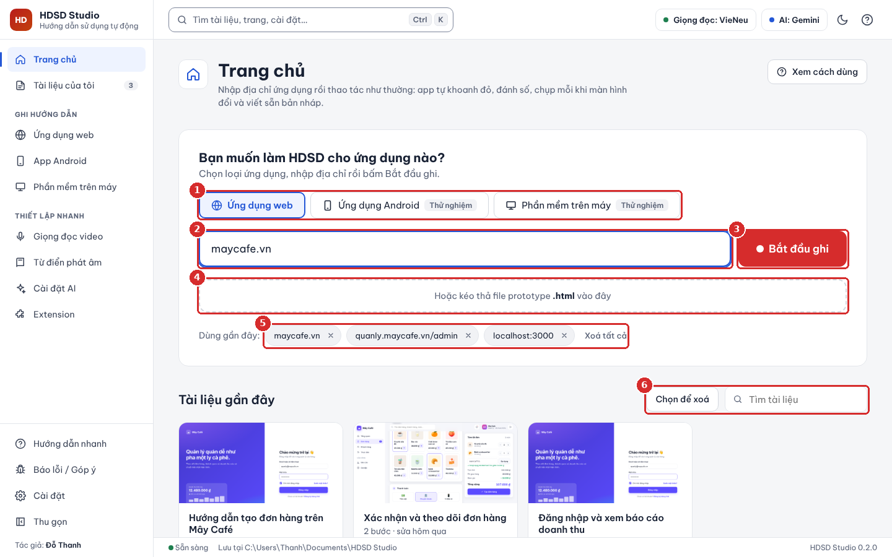
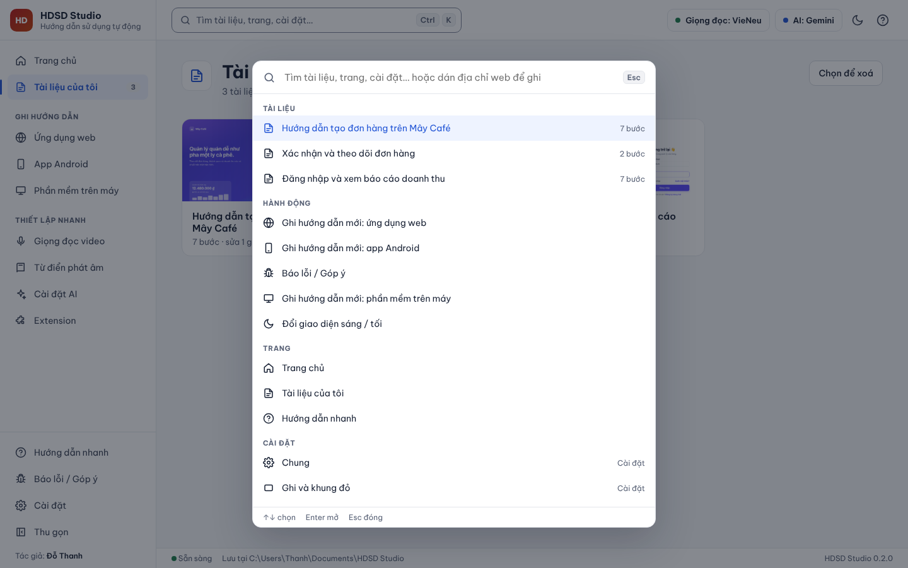
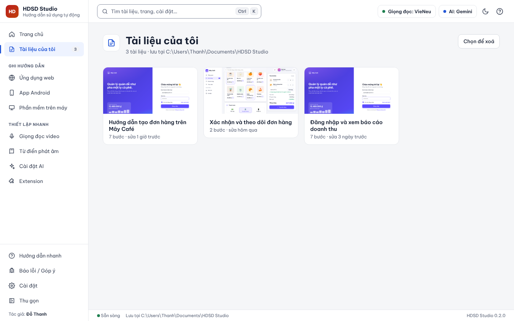

# 2. Làm quen giao diện

[← Mục lục](README.md)

## 2.1. Trang chủ

Trang chủ là nơi bắt đầu mọi hướng dẫn mới.

| Số | Phần | Dùng để |
|---|---|---|
| 1 | **Loại ứng dụng** | Chọn **Ứng dụng web**, **Ứng dụng Android** hoặc **Phần mềm trên máy**. Mỗi loại có cách ghi riêng (xem trang [3](03-ghi-web.md), [4](04-ghi-phan-mem.md), [5](05-ghi-android.md)) |
| 2 | **Địa chỉ ứng dụng** | Nhập địa chỉ trang web, ví dụ `abc.vn`, `localhost:3000`, `192.168.1.20:8080`. Không cần gõ `https://` |
| 3 | **Bắt đầu ghi** | Mở trang web và bắt đầu ghi |
| 4 | **Kéo thả file .html** | Ghi một bản thiết kế (prototype) dạng file `.html` có sẵn trên máy |
| 5 | **Dùng gần đây** | Các địa chỉ bạn đã ghi. Bấm vào để điền lại. Bấm **×** để xoá một địa chỉ, **Xoá tất cả** để xoá hết |
| 6 | **Tài liệu gần đây** | Ô **Tìm tài liệu** để lọc theo tên, nút **Chọn để xoá** để xoá nhiều tài liệu |

Bên dưới là các thẻ **Tài liệu gần đây**. Mỗi thẻ có ảnh bước đầu, tên tài liệu, số bước và thời gian sửa gần nhất. **Bấm vào thẻ** để mở màn Biên tập.

## 2.2. Thanh bên trái

| Nhóm | Mục | Dùng để |
|---|---|---|
| | **Trang chủ** | Về Trang chủ |
| | **Tài liệu của tôi** | Xem mọi tài liệu (số bên cạnh là tổng số tài liệu) |
| **Ghi hướng dẫn** | **Ứng dụng web**, **App Android**, **Phần mềm trên máy** | Mở Trang chủ với loại ứng dụng tương ứng đã chọn sẵn |
| **Thiết lập nhanh** | **Giọng đọc video**, **Từ điển phát âm**, **Cài đặt AI**, **Extension** | Mở thẳng mục cài đặt tương ứng |
| | **Hướng dẫn nhanh** | Xem lại các trang giới thiệu |
| | **Báo lỗi / Góp ý** | Gửi lỗi hoặc ý tưởng cho tác giả, xem [trang 12](12-bao-loi-hoi-dap.md) |
| | **Cài đặt** | Mọi cài đặt của app, xem [trang 11](11-cai-dat-app.md) |
| | **Thu gọn** | Thu thanh bên chỉ còn biểu tượng, cho màn làm việc rộng hơn. Bấm **Mở rộng** để mở lại |

## 2.3. Thanh trên cùng

- **Ô tìm kiếm** (Ctrl + K): tìm tài liệu, trang, cài đặt. Xem [2.5](#25-tìm-nhanh-ctrl--k).
- **Giọng đọc: …**: giọng đang dùng cho video (Giọng máy hoặc VieNeu). Bấm để mở cài đặt giọng đọc.
- **AI: …**: AI đang dùng (Claude hoặc Gemini). Chấm xanh là đã có API key. Bấm để mở cài đặt AI.
- **Mặt trăng / mặt trời**: đổi giao diện tối / sáng.
- **?**: mở Hướng dẫn nhanh.

## 2.4. Thanh trạng thái dưới cùng

- **Sẵn sàng**: app đang chạy bình thường.
- **Lưu tại …**: thư mục đang lưu tài liệu.
- **HDSD Studio x.y.z**: phiên bản đang dùng. Khi có bản mới, chỗ này hiện **"Có bản mới x.y.z – xem"**.
- Khi máy mất mạng, app báo **"Không có mạng"**: các tính năng AI và tải giọng đọc tạm không dùng được, còn ghi, biên tập, xuất file vẫn chạy bình thường.

## 2.5. Tìm nhanh (Ctrl + K)

Bấm **Ctrl + K** (⌘ K trên Mac) hoặc bấm vào ô tìm kiếm trên cùng.

Kết quả chia nhóm:
- **Tài liệu**: mở nhanh một tài liệu theo tên, kèm số bước.
- **Hành động**: ghi hướng dẫn mới (web, Android, phần mềm trên máy), báo lỗi, đổi giao diện sáng / tối.
- **Trang**: Trang chủ, Tài liệu của tôi, Hướng dẫn nhanh.
- **Cài đặt**: đi thẳng tới từng mục cài đặt.

Mẹo: **dán một địa chỉ web** vào ô này rồi bấm Enter để **bắt đầu ghi ngay** trang đó.

Phím: **↑ ↓** chọn, **Enter** mở, **Esc** đóng.

## 2.6. Tài liệu của tôi

Hiện **mọi tài liệu**, kèm tổng số và thư mục đang lưu. Bấm thẻ để mở.

**Xoá một tài liệu:** rê chuột vào thẻ, bấm biểu tượng **thùng rác**, xác nhận **Xoá tài liệu**.

**Xoá nhiều tài liệu:**
1. Bấm **Chọn để xoá**.
2. Tích các tài liệu cần xoá (hoặc **Chọn tất cả**).
3. Bấm **Xoá n**, xác nhận.

Tài liệu bị xoá được chuyển vào **Thùng rác** của máy, vẫn khôi phục được.

## 2.7. Tài liệu được lưu ở đâu

- Mặc định ở thư mục **`Documents/HDSD Studio`**. Đổi được trong **Cài đặt › Lưu trữ và bảo mật**.
- Mỗi tài liệu là **một thư mục** gồm ảnh gốc và dữ liệu.
- Khung đỏ, số và vùng mờ được lưu riêng, **ảnh gốc không bị vẽ đè**, nên bạn sửa lại được bất cứ lúc nào.
- App **tự lưu** mọi thay đổi, không có nút Lưu.

[← Trang trước](01-cai-dat.md) · [Trang sau: Ghi ứng dụng web →](03-ghi-web.md)
