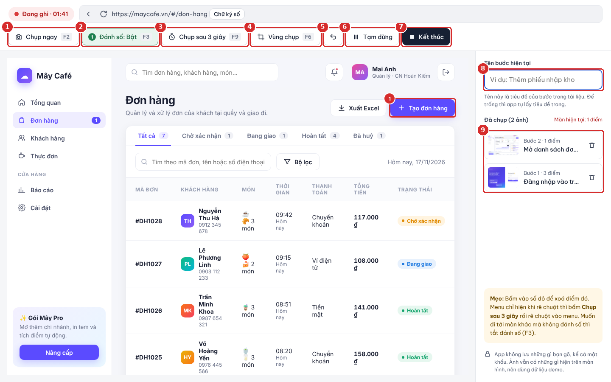
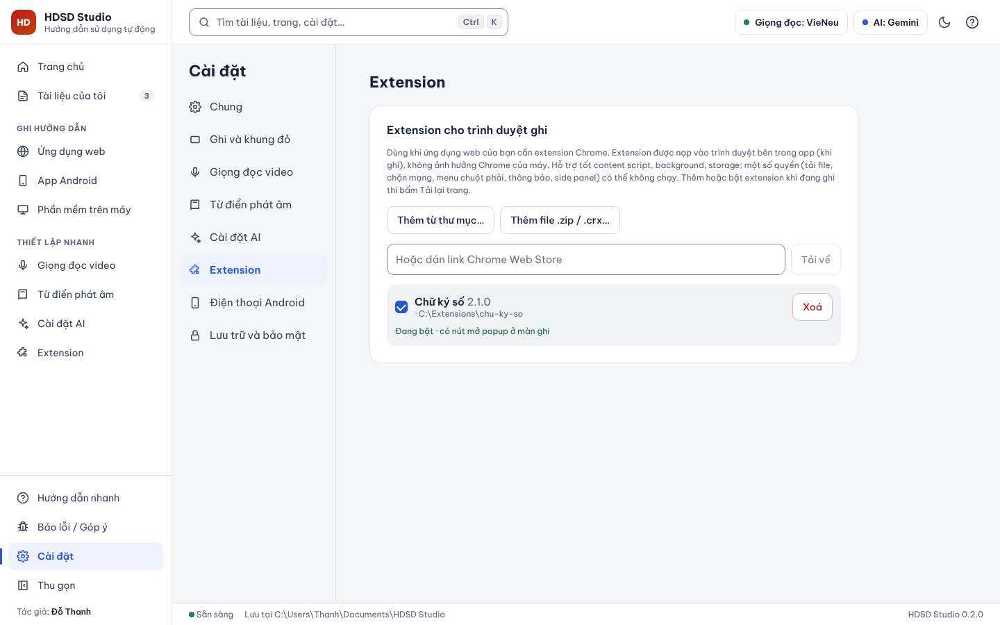

# 3. Ghi ứng dụng web

[← Mục lục](README.md)

Dùng cho mọi phần mềm chạy trên trình duyệt: trang quản trị, phần mềm quản lý, trang bán hàng, cổng thông tin, bản thiết kế `.html`…

## 3.1. Bắt đầu ghi

1. Ở **Trang chủ**, chọn **Ứng dụng web**.
2. Nhập **địa chỉ ứng dụng**, ví dụ:
   - `abc.vn` hoặc `https://abc.vn/dang-nhap`
   - `localhost:3000` (phần mềm đang chạy trên máy bạn)
   - `192.168.1.20:8080` (phần mềm trong mạng nội bộ)
3. Bấm **Bắt đầu ghi**.

**Ghi một bản thiết kế có sẵn:** kéo thả file **`.html`** (prototype) vào ô **"Hoặc kéo thả file prototype .html vào đây"**. App mở file đó và bắt đầu ghi luôn.

## 3.2. Màn ghi

Màn ghi gồm: **thanh công cụ** trên cùng, **trang web** ở giữa bên trái (bạn thao tác trực tiếp ở đây), và **cột Các bước** bên phải.

| Số | Nút | Phím | Dùng để |
|---|---|---|---|
| 1 | **Chụp ngay** | F2 | Chụp màn hình hiện tại thành một bước ngay lập tức. Dùng khi màn hình không tự đổi, hoặc khi muốn chốt bước trước khi sang việc mới |
| 2 | **Đánh số: Bật / Tắt** | F3 | Tắt khi chỉ muốn **đi tới** màn khác mà không muốn khoanh số. Số nhỏ trên nút là số điểm đã khoanh ở màn hiện tại |
| 3 | **Chụp sau 3 giây** | F9 | Đếm ngược 3 giây rồi chụp. Dùng cho **menu chỉ hiện khi rê chuột** |
| 4 | **Vùng chụp** | F6 | Chỉ chụp một **vùng** của trang thay vì toàn trang |
| 5 | **Hoàn tác** (mũi tên cong) | F8 / F7 | Bỏ số cuối cùng, hoặc xoá bước vừa chụp |
| 6 | **Tạm dừng / Ghi tiếp** | | Tạm ngừng ghi để thao tác tự do (đăng nhập, chuẩn bị dữ liệu…) mà không bị khoanh số |
| 7 | **Kết thúc** | | Dừng ghi và mở màn **Biên tập** |
| 8 | **Tên bước hiện tại** | | Gõ tên cho bước đang ghi, ví dụ "Thêm phiếu nhập kho". Để trống thì app lấy tiêu đề trang |
| 9 | **Đã chụp (n ảnh)** | | Danh sách bước đã chụp, mới nhất ở trên. Bấm **thùng rác** để xoá một bước |

Trên cùng còn có:
- Đèn đỏ **Đang ghi · 01:41**: thời gian đã ghi. Khi tạm dừng sẽ hiện **Đang tạm dừng**.
- **Thanh địa chỉ** với nút **Quay lại trang trước** (←) và **Tải lại trang** (⟳).
- Nút **extension** (nếu có extension có popup), ví dụ **Chữ ký số**, bấm để mở popup của extension đó.

## 3.3. App ghi như thế nào

1. **Bấm vào đâu, app khoanh đỏ và đánh số ở đó** (1, 2, 3…). Bấm vào ô nhập, nút, đường link, ô chọn… đều được khoanh.
2. App **tự viết sẵn câu mô tả** cho mỗi điểm dựa vào nút hoặc ô bạn bấm, ví dụ "Bấm nút Lưu", "Nhập Tên đăng nhập", "Chọn Đối tượng".
3. **Khi màn hình đổi** (chuyển trang, mở cửa sổ mới, mở form mới), app lưu ảnh **ngay trước cú bấm cuối** thành một bước, có đủ các số của màn hình đó. Góc màn hình hiện thông báo **"Đã chụp Bước n · m điểm"**.
4. **Khi mở hộp thoại (modal, popup)**, app **tự chụp màn hình ngay trước khi hộp thoại hiện ra**, không cần bấm F2. Khi hộp thoại đóng lại, app cũng tự lưu hộp thoại đó thành một bước. Xem [Mở hộp thoại](#mở-hộp-thoại-modal-popup).
5. Bước mới hiện ở cột **Đã chụp** bên phải.

> **Bảo mật:**
> - App **không ghi lại những gì bạn gõ**, kể cả mật khẩu. App chỉ ghi vị trí và tên của nút hoặc ô bạn bấm.
> - **Ô mật khẩu được tự làm mờ** trong ảnh.
> - Ảnh chụp vẫn có mọi thứ hiện trên màn hình, nên hãy **dùng dữ liệu mẫu** khi ghi.

## 3.4. Sửa ngay khi đang ghi

| Muốn | Làm |
|---|---|
| Bỏ một điểm khoanh sai | **Bấm thẳng vào số đỏ** đó. Các số còn lại tự đánh lại |
| Bỏ điểm vừa khoanh | Bấm **F8** |
| Bỏ hết số trên màn hiện tại | Bấm **F4** |
| Xoá bước vừa chụp | Bấm **F7**, hoặc thùng rác ở cột Đã chụp. Thông báo **"Đã xoá bước n"** có nút hoàn tác để lấy lại |

Không cần sửa kỹ khi đang ghi: mọi thứ đều sửa lại được ở màn Biên tập.

## 3.5. Các tình huống hay gặp

### Trang dài phải cuộn
Khi bạn cuộn xuống làm **các điểm đã khoanh bị khuất quá nửa**, rồi bấm tiếp, app tự:
1. Lưu phần trên thành ảnh.
2. Ghi tiếp phần dưới là **phần tiếp theo của cùng bước** (cột Đã chụp hiện "Bước n (phần 2)").
3. Số thứ tự **chạy tiếp** (1, 2 → 3, 4…).

Trong Word, PDF và video, các phần hiện dưới **cùng một tiêu đề bước**. Muốn bắt đầu **bước mới hẳn**, bấm **F2** (Chụp ngay) trước khi sang việc mới. Ở màn Biên tập có thể **Tách thành bước riêng** hoặc **Gộp vào bước trước**.

### Mở hộp thoại (modal, popup)
Nhiều thao tác mở một **hộp thoại nổi** trên trang (ví dụ bấm **Thêm mới** hiện form nhập, bấm **Xoá** hiện hộp xác nhận) mà **địa chỉ trang không đổi**. Trước đây bạn phải bấm **F2** trước khi bấm nút mở hộp thoại. Giờ app **tự làm việc đó**:

1. Bạn bấm nút mở hộp thoại, ví dụ **Thêm món** (điểm số 3).
2. Ngay khi hộp thoại hiện ra, app **lưu màn hình trước đó** (chưa có hộp thoại, đủ các số 1, 2, 3) thành một bước.
3. Bạn thao tác trong hộp thoại: các số **bắt đầu lại từ 1** trên bước mới.
4. Khi bấm **Lưu** / **Đóng** làm hộp thoại tắt đi, app **tự lưu hộp thoại đó** (có các số bạn vừa khoanh) thành một bước.

Kết quả: mỗi hộp thoại là **một bước riêng**, ảnh rõ ràng, không bị hộp thoại che mất các số của màn hình bên dưới.

Lưu ý:
- Chỉ tự chụp khi **đang bật đánh số**, **không tạm dừng** và **đã có ít nhất một số** trên màn hình. Chưa khoanh điểm nào thì không có gì để lưu.
- **Danh sách xổ xuống, lịch chọn ngày, menu nhỏ** cạnh ô bạn bấm **không** bị coi là hộp thoại, nên không tách bước.
- App nhận ra hộp thoại của hầu hết thư viện giao diện phổ biến (Bootstrap, Ant Design, Element, Material UI, SweetAlert, jQuery UI, Kendo…) và hộp thoại trang tự viết. Nếu hộp thoại nào không được nhận ra, vẫn bấm **F2** trước khi mở như cũ.

### Menu chỉ hiện khi rê chuột
1. Bấm **F9** (Chụp sau 3 giây).
2. Rê chuột vào menu để nó mở ra.
3. Sau 3 giây app tự chụp.

### Đi tới màn khác mà không muốn đánh số
Bấm **F3** để tắt đánh số, đi tới màn cần ghi, rồi bấm **F3** để bật lại. Hoặc bấm **Tạm dừng**, rồi **Ghi tiếp**.

### Chỉ muốn chụp một phần trang
1. Bấm **Vùng chụp** (F6).
2. **Kéo chuột** để vẽ khung quanh phần cần chụp.
3. Bấm **Xong**. Các bước sau chỉ lấy phần trong khung. Nút đổi thành **Vùng chụp: Bật**.
4. Muốn chụp toàn trang lại: bấm **Vùng chụp** rồi chọn **Chụp toàn trang**.

### Trang cần đăng nhập
Đăng nhập như bình thường (có thể bấm **Tạm dừng** trong lúc đăng nhập để không bị khoanh số). App **nhớ đăng nhập** của trang, lần ghi sau không phải gõ lại. Muốn quên: **Cài đặt › Lưu trữ và bảo mật › Thông tin đăng nhập đã nhớ › Xoá**.

### Ghi thêm bước vào tài liệu đã có
Mở tài liệu ở màn Biên tập, bấm **Ghi thêm bước**. App mở lại trang ở bước cuối, bước mới được thêm vào **cuối tài liệu**.

## 3.6. Trang web cần extension Chrome

Một số phần mềm cần extension (chữ ký số, plugin của đơn vị…). Thêm extension trong **Cài đặt › Extension**:

- **Thêm từ thư mục…**: chọn thư mục extension đã giải nén (có file `manifest.json`).
- **Thêm file .zip / .crx…**: chọn file extension.
- **Dán link Chrome Web Store** vào ô, bấm **Tải về**.

Mỗi extension có ô tích để **bật / tắt**, nút **Nạp lại** (sau khi sửa extension) và **Xoá**. Extension có popup sẽ có nút mở popup trên thanh địa chỉ ở màn ghi.

Lưu ý:
- Extension chỉ chạy trong trình duyệt bên trong app, **không ảnh hưởng Chrome** của máy.
- Thêm hoặc bật extension khi đang ghi thì bấm **Tải lại trang**.
- Một số quyền của extension (tải file, chặn mạng, menu chuột phải, thông báo, side panel) có thể không chạy. App ghi rõ dưới tên extension nếu có.

[← Trang trước](02-lam-quen.md) · [Trang sau: Ghi phần mềm trên máy →](04-ghi-phan-mem.md)
