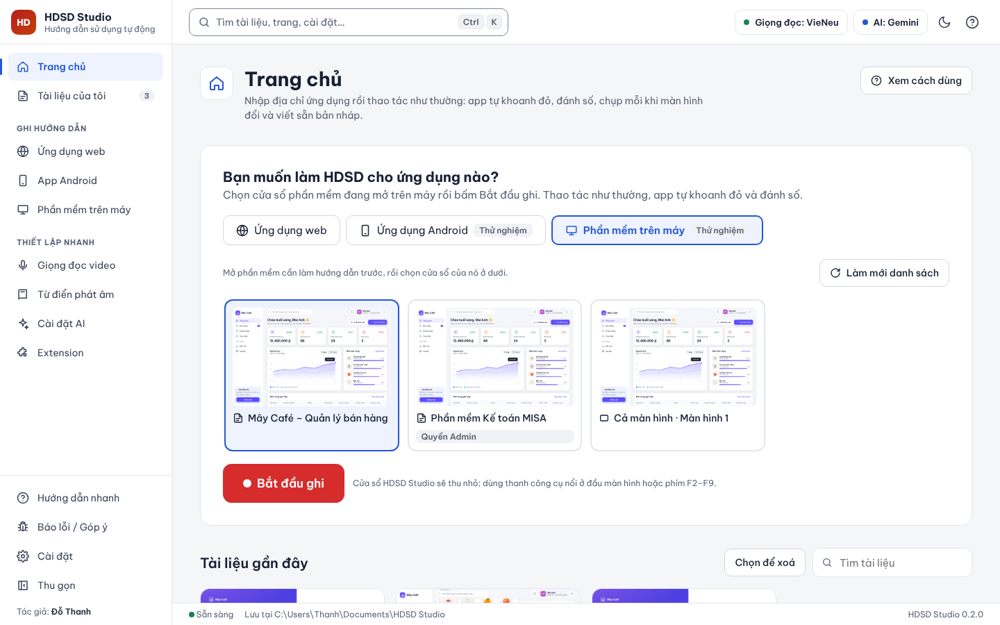
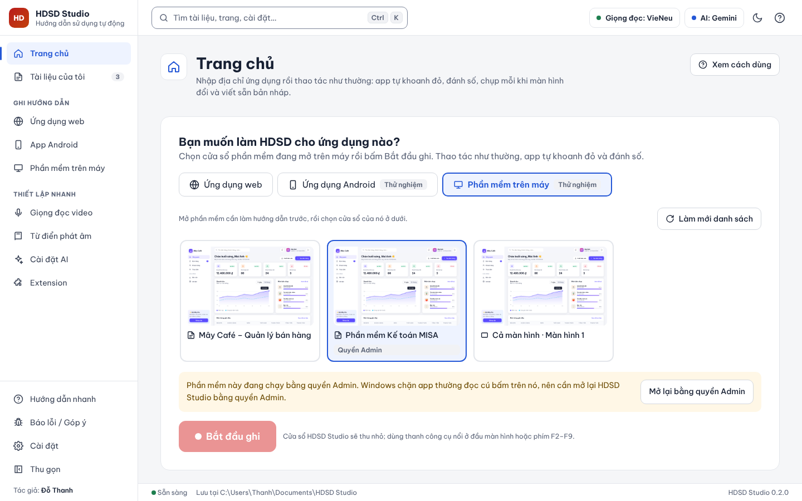
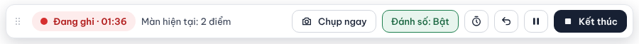

# 4. Ghi phần mềm trên máy

[← Mục lục](README.md)

Dùng để làm hướng dẫn cho phần mềm **cài trên Windows hoặc macOS**: phần mềm kế toán, quản lý bán hàng, phần mềm nội bộ… *(Tính năng đang thử nghiệm.)*

## 4.1. Bắt đầu ghi

1. **Mở phần mềm cần làm hướng dẫn trước.**
2. Ở **Trang chủ**, chọn **Phần mềm trên máy**.
3. App hiện ảnh nhỏ của các **cửa sổ đang mở**. Bấm chọn **cửa sổ của phần mềm** cần ghi, hoặc **Cả màn hình**.
   - Không thấy cửa sổ? Bấm **Làm mới danh sách**. Cửa sổ bị thu nhỏ xuống thanh tác vụ sẽ không hiện.
4. Bấm **Bắt đầu ghi**.

## 4.2. Trên macOS: cấp 2 quyền (làm 1 lần)

Lần đầu, app hiện hộp **"macOS cần bạn cho phép 2 quyền"**:

| Quyền | Để làm gì |
|---|---|
| **Ghi màn hình** | Chụp ảnh cửa sổ phần mềm cho từng bước |
| **Trợ năng** | Biết bạn bấm vào đâu và tên nút / ô được bấm |

1. Bấm **Mở Cài đặt hệ thống** ở từng dòng.
2. Trong **Quyền riêng tư & Bảo mật**, bật **HDSD Studio** ở cả hai mục.
3. Bấm **Mở lại HDSD Studio** (quyền Ghi màn hình chỉ có hiệu lực sau khi mở lại app).
4. Bấm **Kiểm tra lại**. Cả hai dòng chuyển thành **Đã bật** là xong.

App chỉ dùng hai quyền này **khi bạn đang ghi**.

## 4.3. Trên Windows: phần mềm chạy quyền Admin

Nếu phần mềm cần ghi đang chạy bằng **quyền Admin**, thẻ của nó có nhãn **Quyền Admin**. Windows chặn app thường đọc cú bấm trên phần mềm này.

Bấm **Mở lại bằng quyền Admin** để mở lại HDSD Studio với quyền tương ứng, rồi chọn lại cửa sổ và bấm **Bắt đầu ghi**.

## 4.4. Khi đang ghi

- Cửa sổ HDSD Studio **tự thu nhỏ**. Bạn thao tác **trực tiếp trên phần mềm** như thường.
- Ở **đầu màn hình** có **thanh công cụ nổi**:

  Từ trái sang phải: **chấm kéo** (kéo để dời thanh sang chỗ khác), **Đang ghi · thời gian**, **Màn hiện tại: n điểm**, **Chụp ngay**, **Đánh số: Bật/Tắt**, **Chụp sau 3 giây** (đồng hồ), **Hoàn tác**, **Tạm dừng** và **Kết thúc**.
- Thanh công cụ và khung đỏ **không lọt vào ảnh chụp**.
- Các phím **F2, F3, F4, F7, F8, F9** dùng được như khi ghi web. Xem [bảng phím tắt](03-ghi-web.md#32-màn-ghi).
- Mỗi cú bấm được khoanh đỏ và đánh số. Khi màn hình phần mềm đổi, ảnh ngay trước cú bấm cuối được lưu thành một bước.
- Bấm **Kết thúc** trên thanh công cụ nổi để mở màn Biên tập.

## 4.5. Lưu ý

- Nếu cửa sổ đang ghi bị **đóng hoặc thu nhỏ**, app báo **"Không thấy cửa sổ đang ghi"**. Mở lại cửa sổ đó để ghi tiếp.
- Ô mật khẩu cũng được tự làm mờ; app không ghi những gì bạn gõ.
- **Ghi thêm bước** cho tài liệu đã ghi từ phần mềm trên máy: ở màn Biên tập bấm **Ghi thêm bước**, chọn lại cửa sổ rồi ghi tiếp. Bước mới thêm vào cuối tài liệu.

[← Trang trước](03-ghi-web.md) · [Trang sau: Ghi ứng dụng Android →](05-ghi-android.md)
