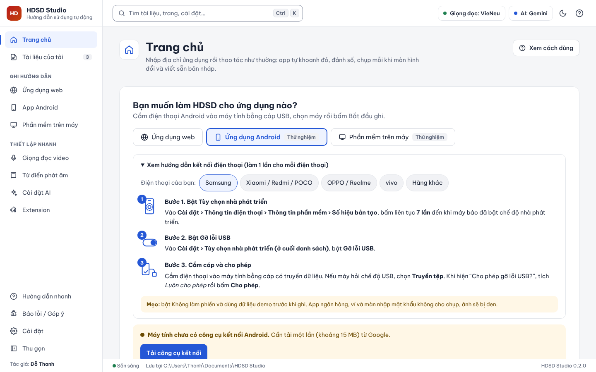
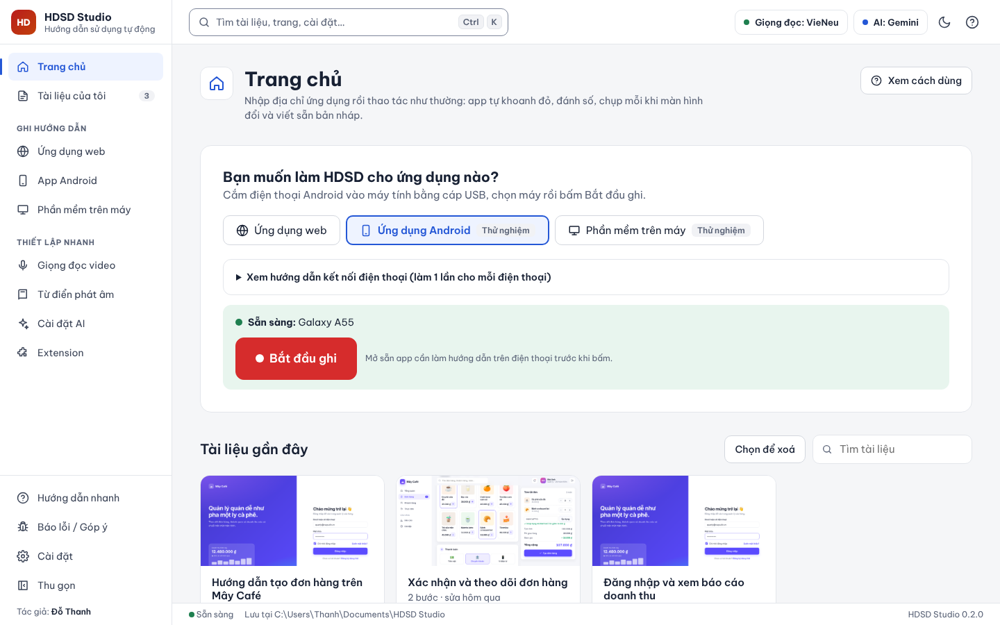

# 5. Ghi ứng dụng Android

[← Mục lục](README.md)

Màn hình điện thoại hiện ngay trên máy tính. Bạn bấm bằng chuột (hoặc chạm trực tiếp trên điện thoại), app tự khoanh đỏ, đánh số và chụp như khi ghi web. *(Tính năng đang thử nghiệm.)*

## 5.1. Bạn cần

- Điện thoại **Android** và **cáp USB có truyền dữ liệu** (cáp chỉ sạc sẽ không nhận).
- Máy tính có mạng để **tải công cụ kết nối Android** một lần (khoảng 15 MB, bản chính thức của Google).

## 5.2. Chuẩn bị điện thoại (làm 1 lần cho mỗi máy)

Ở **Trang chủ**, chọn **Ứng dụng Android**, bấm **Xem hướng dẫn kết nối điện thoại**. Chọn **hãng điện thoại** của bạn để thấy đúng đường dẫn.

### Bước 1. Bật Tùy chọn nhà phát triển
Vào đường dẫn dưới đây, **bấm liên tục 7 lần** vào dòng cuối cho tới khi máy báo đã bật chế độ nhà phát triển:

| Hãng | Đường dẫn |
|---|---|
| Samsung | Cài đặt › Thông tin điện thoại › Thông tin phần mềm › **Số hiệu bản tạo** |
| Xiaomi / Redmi / POCO | Cài đặt › Giới thiệu điện thoại › **Phiên bản HyperOS** (hoặc MIUI) |
| OPPO / Realme | Cài đặt › Giới thiệu máy › Phiên bản › **Số bản dựng** |
| vivo | Cài đặt › Hệ thống › Giới thiệu › Thông tin phiên bản phần mềm › **Phiên bản phần mềm** |
| Hãng khác | Cài đặt › Giới thiệu về điện thoại › **Số bản dựng** |

### Bước 2. Bật Gỡ lỗi USB

| Hãng | Đường dẫn |
|---|---|
| Samsung | Cài đặt › Tùy chọn nhà phát triển (ở cuối danh sách) |
| Xiaomi / Redmi / POCO | Cài đặt › Cài đặt bổ sung › Tùy chọn nhà phát triển |
| OPPO / Realme | Cài đặt › Cài đặt bổ sung › Tùy chọn nhà phát triển |
| vivo, hãng khác | Cài đặt › Hệ thống › Tùy chọn nhà phát triển |

Trong đó bật **Gỡ lỗi USB**.

- **Xiaomi**: bật thêm **"Gỡ lỗi USB (Cài đặt bảo mật)"** để bấm được bằng chuột. Máy có thể đòi đăng nhập tài khoản Mi.
- **OPPO / Realme**: nếu bấm bằng chuột không ăn, bật **"Tắt giám sát quyền"**.

### Bước 3. Cắm cáp và cho phép
1. Cắm điện thoại vào máy tính.
2. Nếu điện thoại hỏi chế độ USB, chọn **Truyền tệp**.
3. Khi hiện **"Cho phép gỡ lỗi USB?"**, tích **Luôn cho phép** rồi bấm **Cho phép**.

### Tải công cụ kết nối (lần đầu)
Nếu app báo **"Máy tính chưa có công cụ kết nối Android"**, bấm **Tải công cụ kết nối**. Đây là bản chính thức Android SDK Platform-Tools từ Google; khi tải là bạn đồng ý với điều khoản của Google.

## 5.3. Bắt đầu ghi

1. **Mở sẵn app cần làm hướng dẫn** trên điện thoại.
2. Khi app báo **"Sẵn sàng: tên điện thoại"**, bấm **Bắt đầu ghi**. Nếu cắm nhiều điện thoại, chọn máy muốn ghi.

## 5.4. Điều khiển điện thoại trên máy tính

| Trên máy tính | Tương đương trên điện thoại |
|---|---|
| Bấm chuột | Chạm |
| Giữ chuột | Nhấn giữ |
| Kéo chuột | Vuốt |
| Lăn chuột | Cuộn |

Thanh trên cùng có thêm:
- **Quay lại (Back)**, **Màn hình chính (Home)**, **Ứng dụng gần đây**.
- **Ô gõ chữ**: gõ rồi bấm **Enter** để gửi chữ sang ô đang nhập trên điện thoại. Có nút **Enter** để bấm phím Enter trên điện thoại.
- **Vùng chụp**: kéo chuột để chỉ chụp một phần màn hình điện thoại, bấm **Xong**; **Chụp toàn màn hình** để bỏ.

Các nút **Chụp ngay, Đánh số, Chụp sau 3 giây, Hoàn tác, Tạm dừng, Kết thúc** và phím tắt dùng giống [ghi web](03-ghi-web.md#32-màn-ghi).

Bạn cũng có thể **chạm trực tiếp trên điện thoại**: app vẫn tự khoanh và chụp.

## 5.5. Mẹo

- Bật **Không làm phiền** trên điện thoại để thông báo không lọt vào ảnh.
- Dùng **dữ liệu mẫu**.
- App ngân hàng, ví điện tử và màn nhập mật khẩu **không cho chụp**, ảnh sẽ bị đen. Đây là bảo mật của các app đó.

## 5.6. Không nhận điện thoại?

| App báo | Cách xử lý |
|---|---|
| **"… chưa cho phép"** | Mở khoá điện thoại, bấm **Cho phép** trong hộp "Cho phép gỡ lỗi USB?". Không thấy hộp: rút cáp cắm lại. Vẫn không được: vào Tùy chọn nhà phát triển, bấm **Thu hồi quyền gỡ lỗi USB** rồi cắm lại |
| **"… đang mất kết nối"** | Rút cáp ra cắm lại, hoặc tắt rồi bật lại Gỡ lỗi USB |
| **"Chưa thấy điện thoại"** | Đổi cáp khác hoặc cổng USB khác, chọn **Truyền tệp** trên điện thoại. Trên Windows có thể cần cài **driver USB của hãng** (ví dụ Samsung USB Driver) |
| **"Điện thoại chặn bấm từ máy tính"** | Chạm trực tiếp trên điện thoại, app vẫn khoanh và chụp. Hoặc bật tuỳ chọn riêng của hãng ở Bước 2 |

[← Trang trước](04-ghi-phan-mem.md) · [Trang sau: Biên tập tài liệu →](06-bien-tap.md)
