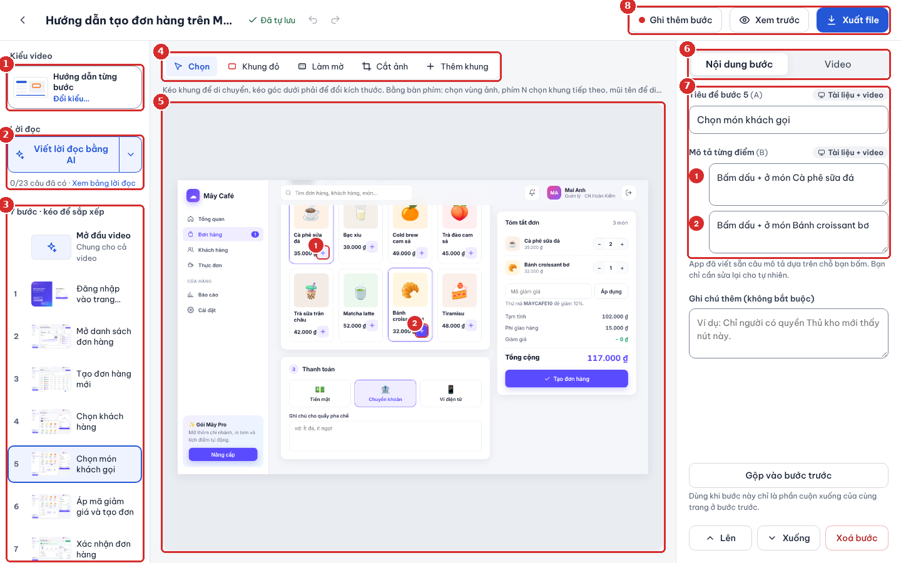
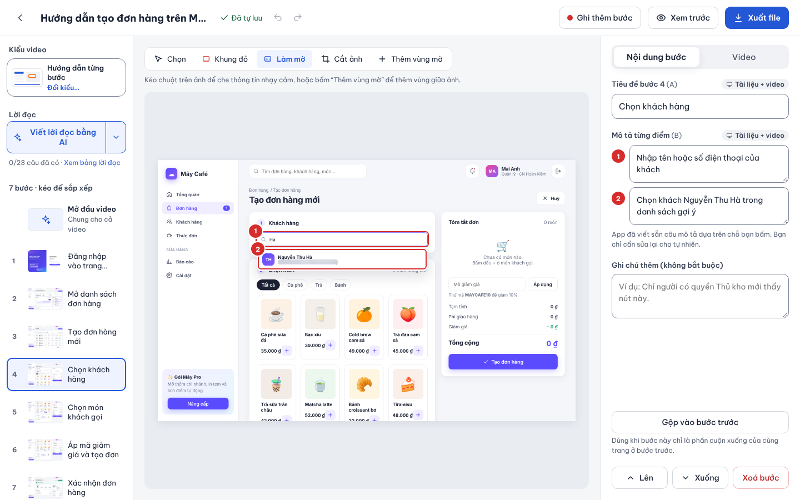
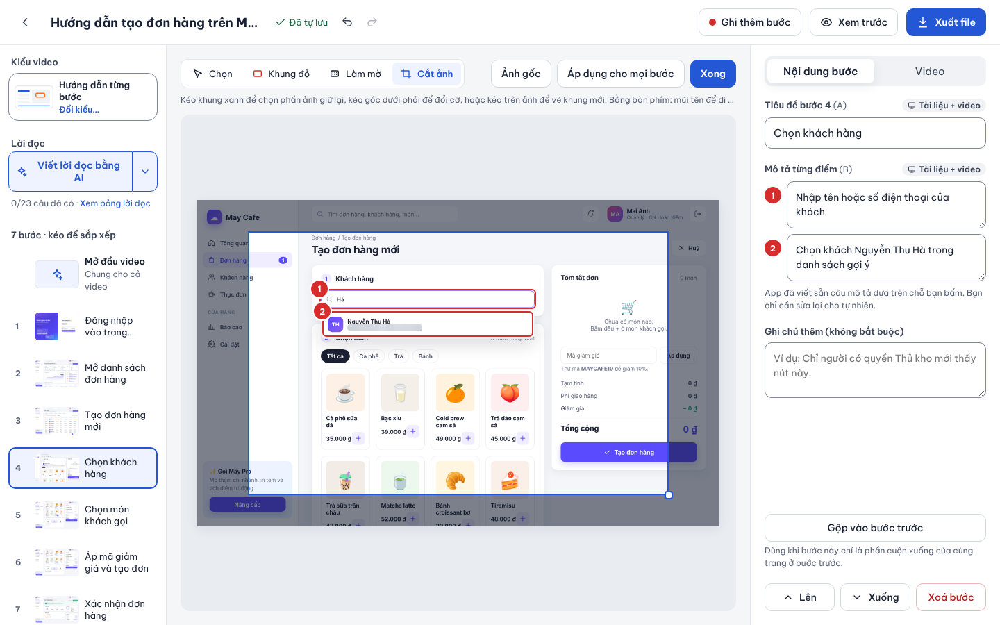
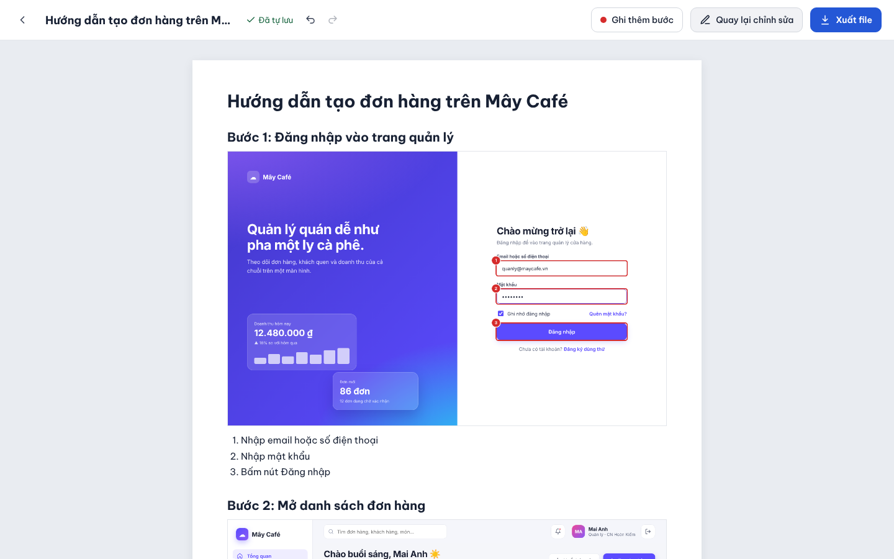

# 6. Biên tập tài liệu

[← Mục lục](README.md)

Bấm **Kết thúc** khi ghi, hoặc bấm một tài liệu ở Trang chủ, bạn sẽ vào màn **Biên tập**. Mọi thay đổi **tự lưu**: góc trên hiện **"Đã tự lưu"** (hoặc "Đang lưu…").

## 6.1. Bố cục màn Biên tập

| Số | Phần | Dùng để |
|---|---|---|
| 1 | **Kiểu video** | Kiểu video đang dùng cho tài liệu. Bấm **Đổi kiểu…** để chọn kiểu khác, xem [trang 8](08-video.md) |
| 2 | **Lời đọc** | Nút **Viết lời đọc bằng AI**, số câu lời đọc đã có, link **Xem bảng lời đọc**. Xem [trang 7](07-ai.md) |
| 3 | **Danh sách bước** | Mọi bước của tài liệu, **kéo thả để sắp xếp**. Trong danh sách có thêm **Mở đầu video** và **Kết thúc video** (dùng chung cho cả video) |
| 4 | **Công cụ chú thích** | **Chọn**, **Khung đỏ**, **Làm mờ**, **Cắt ảnh**, **Thêm khung** |
| 5 | **Ảnh của bước** | Ảnh đang chọn, có khung đỏ và số. Sửa trực tiếp trên ảnh |
| 6 | **Nội dung bước / Video** | Hai thẻ thuộc tính của bước: **Nội dung bước** (cho tài liệu) và **Video** (cho video, xem [trang 8](08-video.md#84-chỉnh-từng-bước-trong-video)) |
| 7 | **Tiêu đề và mô tả từng điểm** | Sửa tên bước và câu mô tả của từng số |
| 8 | **Ghi thêm bước, Xem trước, Xuất file** | Ghi tiếp, xem tài liệu như khi xuất, sang màn Xuất file |

Trên cùng bên trái: nút **←** về Trang chủ, **tên tài liệu** (bấm vào để sửa), nút **Hoàn tác** và **Làm lại**.

## 6.2. Sửa nội dung bước

Chọn một bước ở danh sách bên trái, rồi ở thẻ **Nội dung bước**:

1. **Tiêu đề bước**: tên bước, ví dụ "Chọn món khách gọi". Nhãn **Tài liệu + video** nghĩa là chữ này hiện ở cả tài liệu lẫn video.
2. **Mô tả từng điểm**: mỗi số đỏ có một câu. App đã **viết sẵn** dựa trên chỗ bạn bấm, bạn chỉ cần sửa lại cho tự nhiên. Bấm vào một câu thì khung số tương ứng được chọn trên ảnh.
3. **Ghi chú thêm** (không bắt buộc): dòng lưu ý dưới bước, ví dụ "Chỉ người có quyền Thủ kho mới thấy nút này."

Mẹo viết mô tả:
- Bắt đầu bằng động từ: **Bấm**, **Nhập**, **Chọn**, **Tích**.
- Ghi đúng tên nút trong phần mềm: "Bấm **Lưu**", không phải "Bấm nút ở góc phải".

## 6.3. Công cụ chú thích trên ảnh

### Chọn, di chuyển, đổi cỡ khung đỏ
- Công cụ **Chọn**: bấm vào khung để chọn. **Kéo khung** để di chuyển, **kéo góc dưới phải** để đổi kích thước.
- Bấm nút **Xoá khung đang chọn** (hoặc phím **Delete**) để xoá. Các số còn lại tự đánh lại.

### Vẽ thêm khung đỏ
- Chọn **Khung đỏ**, **kéo chuột trên ảnh** để vẽ khung mới.
- Hoặc bấm **Thêm khung** để thêm một khung ở giữa ảnh rồi kéo tới chỗ cần.
- Khung mới có số tiếp theo và một ô mô tả mới ở cột phải.

### Làm mờ thông tin nhạy cảm
Dùng để che tên thật, số điện thoại, số tài khoản, email…

1. Chọn **Làm mờ**.
2. **Kéo chuột** trên vùng cần che, hoặc bấm **Thêm vùng mờ**.
3. Kéo vùng mờ để chỉnh vị trí, kéo góc để đổi cỡ. **Xoá vùng mờ đang chọn** để bỏ.

Vùng mờ được áp dụng cho Word, PDF, ảnh, video, và cả ảnh gửi cho AI.

### Cắt ảnh
Dùng để bỏ phần thừa (thanh bên, phần trống…) cho ảnh gọn hơn.

1. Chọn **Cắt ảnh**. Trên ảnh hiện **khung xanh**.
2. Kéo khung xanh để chọn **phần ảnh giữ lại**, kéo góc dưới phải để đổi cỡ, hoặc kéo trên ảnh để vẽ khung mới.
3. Muốn mọi bước cắt giống nhau: bấm **Áp dụng cho mọi bước**.
4. Bấm **Xong**.

Muốn dùng lại toàn bộ ảnh: chọn **Cắt ảnh** rồi bấm **Ảnh gốc** (Bỏ cắt). Ảnh gốc luôn được giữ, cắt bao nhiêu lần cũng được.

### Dùng bàn phím
Bấm vào vùng ảnh rồi:

| Phím | Việc |
|---|---|
| **N** | Chọn khung tiếp theo |
| **Mũi tên** | Di chuyển khung |
| **Alt + mũi tên** | Đổi kích thước (giữ **Shift**: 10px mỗi lần) |
| **Delete** | Xoá khung |

Màu và độ dày khung đỏ đổi trong **Cài đặt › Ghi và khung đỏ**.

## 6.4. Sắp xếp các bước

Ở cuối thẻ Nội dung bước có các nút:

| Nút | Việc |
|---|---|
| **Lên / Xuống** | Đổi vị trí bước (hoặc **kéo thả** trong danh sách bên trái) |
| **Xoá bước** | Xoá bước. Thông báo **"Đã xoá bước n"** có nút **Hoàn tác** nếu lỡ tay |
| **Gộp vào bước trước** | Nối ảnh này vào bước trước như **phần tiếp theo**. Dùng khi bước này chỉ là phần cuộn xuống của cùng trang ở bước trước. Số các điểm chạy tiếp theo bước trước |
| **Tách thành bước riêng** | Ngược lại với Gộp: phần tiếp theo (do cuộn trang dài) thành **một bước riêng** có số thứ tự, tiêu đề và ghi chú của nó |

Bước là **phần tiếp theo** hiện chữ "Phần 2" trong danh sách. Tiêu đề, ghi chú, lưu ý của nó lấy theo phần đầu.

## 6.5. Thêm bước

### Ghi thêm
Bấm **Ghi thêm bước** (góc trên phải). App mở lại đúng nguồn đã ghi (trang web, phần mềm trên máy hoặc điện thoại). Bước mới được thêm vào **cuối tài liệu**.

### Thêm từ ảnh có sẵn
Dùng khi bạn đã có ảnh chụp màn hình (PNG, JPG).

1. Bấm **Thêm ảnh từ máy** ở cuối danh sách bước, hoặc **kéo thả ảnh** vào cột danh sách bước.
2. Hộp **Thêm bước từ ảnh** hiện ra:
   - **Chèn vào**: **Cuối tài liệu** hoặc **Sau bước n**.
   - Gõ **tiêu đề** cho từng ảnh (để trống sẽ là "Bước mới").
   - Kéo để đổi thứ tự, hoặc bấm **Lên / Xuống**. Bấm **×** để bỏ một ảnh. **Chọn thêm ảnh** nếu thiếu.
3. Bấm **Thêm n bước**.
4. Vẽ khung đỏ cho từng bước bằng công cụ **Khung đỏ**.

Ảnh được chép vào tài liệu, file gốc trên máy giữ nguyên. Ảnh lớn hơn 30 MB hoặc không phải PNG/JPG sẽ bị bỏ qua.

## 6.6. Hoàn tác và Làm lại

Mọi thao tác trong màn Biên tập đều hoàn tác được:
- **Hoàn tác**: nút mũi tên cong trái, hoặc **Ctrl + Z** (⌘ Z trên Mac).
- **Làm lại**: nút mũi tên cong phải, hoặc **Ctrl + Y** / **Ctrl + Shift + Z**.

## 6.7. Xem trước

Bấm **Xem trước** để xem tài liệu như khi xuất ra Word / PDF: tiêu đề, ảnh có khung đỏ, danh sách thao tác của từng bước.

Bấm **Quay lại chỉnh sửa** để sửa tiếp.

[← Trang trước](05-ghi-android.md) · [Trang sau: AI viết lời đọc →](07-ai.md)
