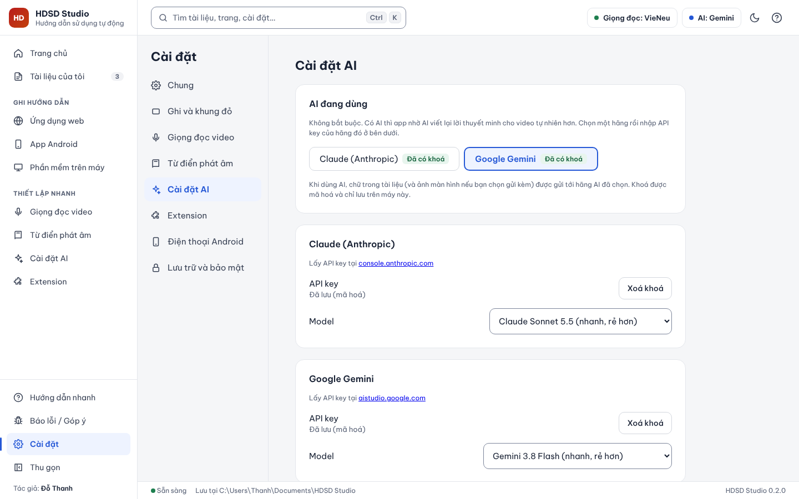
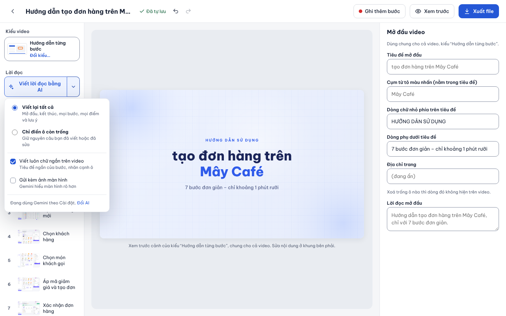
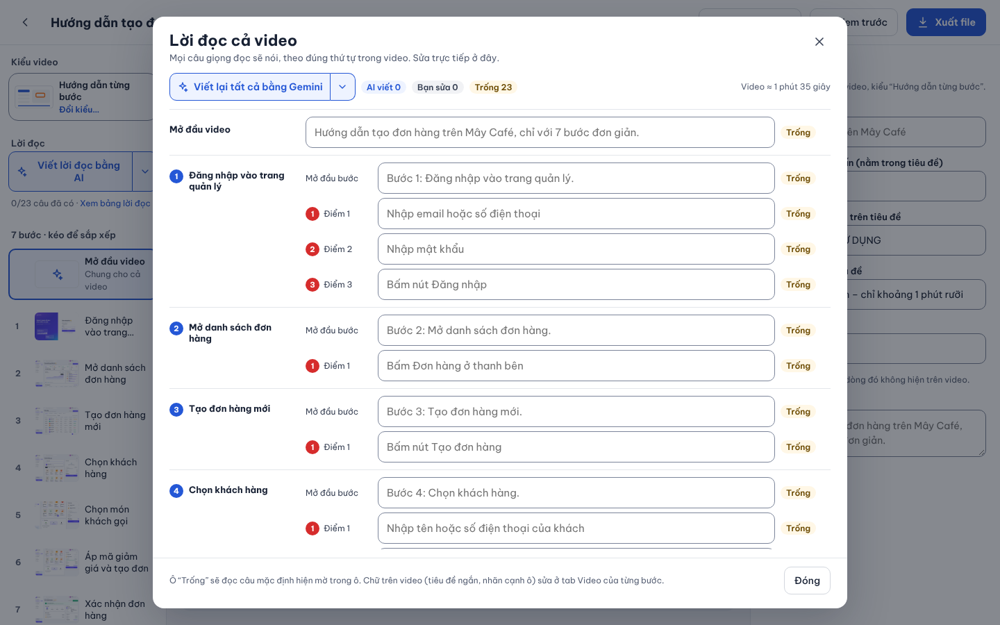

# 7. AI viết lời đọc

[← Mục lục](README.md)

Chỉ với một nút, AI viết lại **lời đọc cho cả video**: câu mở đầu, câu kết, lời mở đầu từng bước, lời đọc từng điểm, cảnh lưu ý, và cả **tiêu đề ngắn**, **nhãn cạnh ô khoanh** trên video. Câu chữ gọn, tự nhiên như người hướng dẫn thật.

AI **không bắt buộc**: không có AI, app vẫn tự viết câu mô tả từ chỗ bạn bấm, và giọng đọc sẽ đọc các câu đó.

## 7.1. Cài AI (làm 1 lần)

1. Vào **Cài đặt › Cài đặt AI** (hoặc bấm chữ **AI: …** trên cùng).
2. Ở **AI đang dùng**, chọn một hãng: **Claude (Anthropic)** hoặc **Google Gemini**.
3. Lấy **API key** của hãng đó:
   - **Gemini**: vào trang **aistudio.google.com**, đăng nhập tài khoản Google, bấm **Get API key** › **Create API key**, sao chép khoá.
   - **Claude**: vào trang **console.anthropic.com**, đăng nhập, vào **API Keys** › **Create Key**, sao chép khoá.
4. Dán khoá vào ô **API key** của hãng đó, bấm **Lưu**. Hiện **"Đã lưu (mã hoá)"** và nhãn **Đã có khoá** là xong.
5. Chọn **Model**:

| Gemini | Claude | Khi nào dùng |
|---|---|---|
| Gemini 4 Argon | Claude Opus 5.5 | Viết hay nhất |
| Gemini 3.8 Flash | Claude Sonnet 5.5 | Nhanh, rẻ hơn (nên dùng) |
| Gemini 3.5 Flash-Lite | Claude Haiku 5.5 | Nhanh nhất, rẻ nhất |

Với Gemini, sau khi lưu khoá bạn còn chọn được **các model khác của tài khoản**, hoặc **nhập tên model khác**.

> **Riêng tư:** khoá được **mã hoá và chỉ lưu trên máy này**. Khi dùng AI, chữ trong tài liệu (và ảnh màn hình nếu bạn chọn gửi kèm) được gửi tới hãng AI đã chọn. Muốn bỏ khoá: bấm **Xoá khoá**.

## 7.2. Viết lời đọc bằng AI

1. Mở tài liệu ở màn **Biên tập**.
2. Ở cột trái, khối **Lời đọc**, bấm mũi tên **⌄** cạnh nút để chọn tuỳ chọn:

| Tuỳ chọn | Ý nghĩa |
|---|---|
| **Viết lại tất cả** | AI viết lại mọi câu: mở đầu, kết thúc, mọi bước, mọi điểm và lưu ý |
| **Chỉ điền ô còn trống** | Giữ nguyên câu bạn đã viết hoặc đã sửa, AI chỉ viết những ô trống |
| **Viết luôn chữ ngắn trên video** | AI viết thêm **tiêu đề ngắn** của bước và **nhãn cạnh ô** khoanh |
| **Gửi kèm ảnh màn hình** | AI xem cả ảnh nên hiểu màn hình rõ hơn. Ảnh gửi đi **đã làm mờ** chỗ bạn che. **Đừng bật nếu ảnh có dữ liệu thật** |

Dòng cuối cho biết AI đang dùng, bấm **Đổi AI** để đổi.

3. Bấm **Viết lời đọc bằng AI**. Nút hiện **"Gemini đang viết…"** (hoặc tên AI bạn chọn).
4. Xong, app báo **"Gemini đã viết n câu lời đọc"**. Nếu lỡ tay, bấm **Hoàn tác** trên thông báo hoặc **Ctrl + Z**.

## 7.3. Bảng lời đọc cả video

Bấm **Xem bảng lời đọc** (dưới nút AI, hoặc trong thẻ Video của bước).

Bảng liệt kê **mọi câu giọng đọc sẽ nói, theo đúng thứ tự trong video**: Mở đầu video › từng bước (Mở đầu bước, Điểm 1, Điểm 2…, Lưu ý) › Kết thúc video. **Sửa trực tiếp** ngay trong bảng.

Mỗi câu có nhãn:

| Nhãn | Nghĩa |
|---|---|
| **AI viết** | Câu do AI viết |
| **Bạn sửa** | Câu bạn tự viết hoặc đã sửa. Khi chọn "Chỉ điền ô còn trống", AI giữ nguyên các câu này |
| **Trống** | Chưa có câu. Giọng đọc sẽ đọc **câu mặc định hiện mờ** trong ô (lấy từ tiêu đề và mô tả điểm) |

Đầu bảng có bộ đếm **AI viết n · Bạn sửa n · Trống n**, độ dài video ước tính, và nút **Viết lại tất cả bằng AI** / **Điền ô trống bằng AI**.

Chữ trên video (tiêu đề ngắn, nhãn cạnh ô) sửa ở **thẻ Video** của từng bước.

## 7.4. AI dịch sang ngôn ngữ khác

AI đã cài ở đây cũng dùng để **dịch tài liệu và lời đọc** sang 11 ngôn ngữ. Xem [trang 13](13-dich-ngon-ngu.md).

## 7.5. Mẹo để AI viết hay hơn

- Đặt **tên bước rõ ràng** khi ghi (ô "Tên bước hiện tại") hoặc ở màn Biên tập.
- Sửa **mô tả từng điểm** cho đúng trước khi nhờ AI, vì AI dựa vào đó.
- Viết tên tài liệu đầy đủ, ví dụ "Hướng dẫn tạo đơn hàng trên Mây Café".
- Sau khi AI viết, ra màn **Xuất file** bấm **Xem trước bước 1** để nghe thử, rồi sửa câu chưa ưng trong bảng lời đọc.
- Từ viết tắt bị đọc sai: khai báo trong **Từ điển phát âm**, xem [9.5](09-giong-doc.md#95-từ-điển-phát-âm).

[← Trang trước](06-bien-tap.md) · [Trang sau: Làm video hướng dẫn →](08-video.md)
