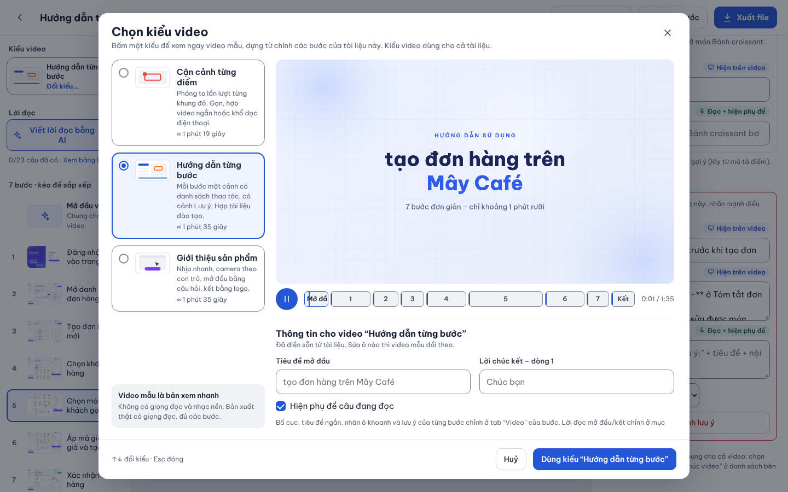
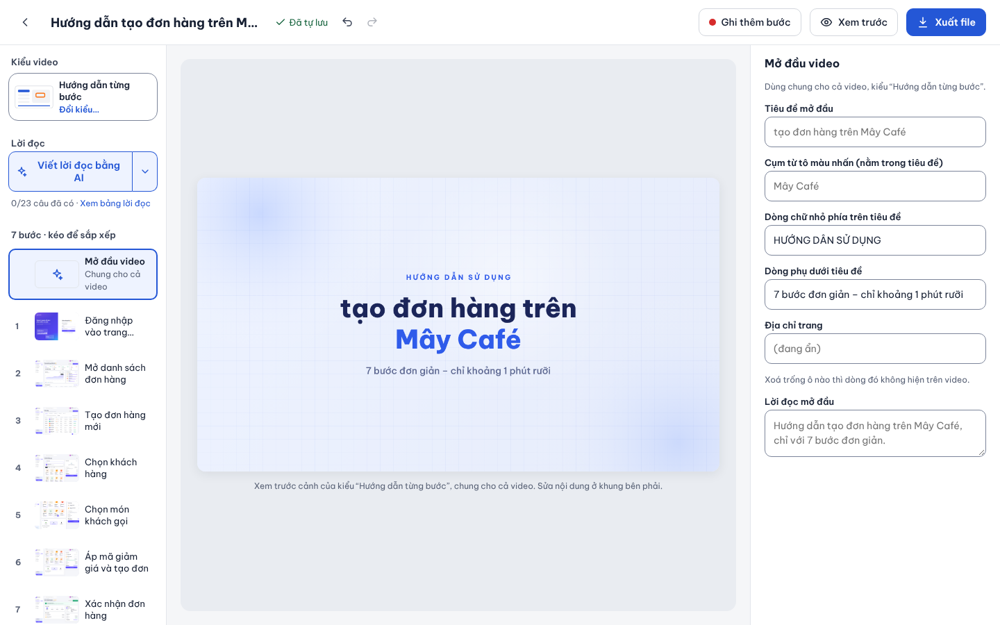
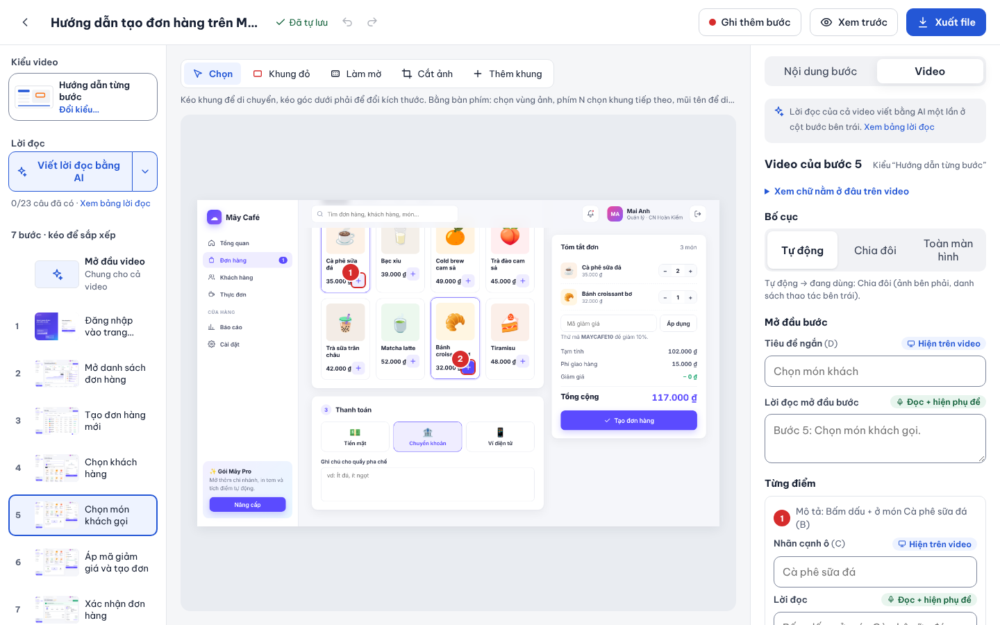
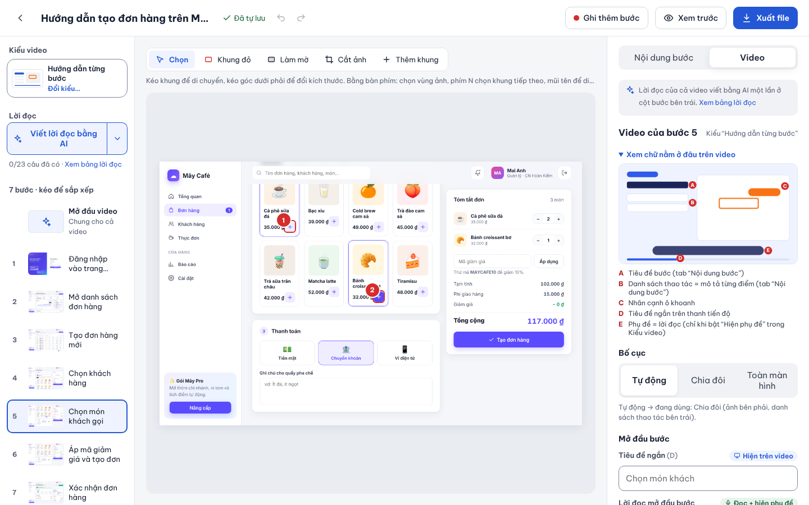
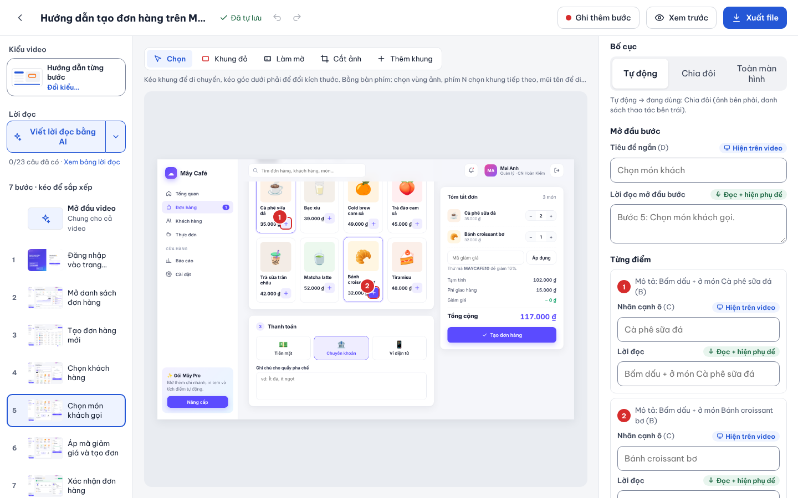
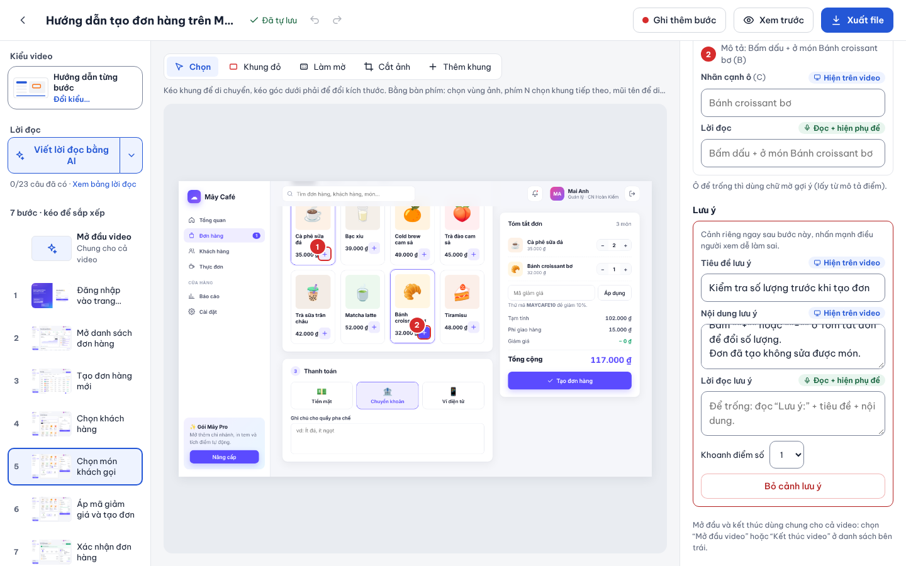

# 8. Làm video hướng dẫn

[← Mục lục](README.md)

Từ chính các bước đã ghi, app **tự dựng video MP4** có giọng đọc, phụ đề và nhạc nền. Bạn không cần phần mềm dựng phim, không cần thu âm.

Quy trình làm video:
1. **Chọn kiểu video** (8.1).
2. Sửa **mở đầu, kết thúc** (8.3) và **chi tiết từng bước** (8.4) nếu muốn.
3. Nhờ **AI viết lời đọc** ([trang 7](07-ai.md)).
4. Chọn **giọng đọc, nhạc nền** và **xuất** ([trang 9](09-giong-doc.md), [trang 10](10-xuat-file.md#103-video-mp4)).

## 8.1. Chọn kiểu video

Ở màn **Biên tập**, khối **Kiểu video** trên cùng bên trái, bấm **Đổi kiểu…**.

Bên trái là 3 kiểu, mỗi kiểu ghi **độ dài ước tính** của video:

| Kiểu | Trông như thế nào | Hợp với |
|---|---|---|
| **Cận cảnh từng điểm** | Máy quay **phóng to lần lượt** tới từng khung đỏ, có phụ đề | Video ngắn, video **khổ dọc** cho điện thoại (TikTok, Reels, Zalo) |
| **Hướng dẫn từng bước** | Cảnh mở đầu, **mỗi bước một cảnh** (danh sách thao tác bên trái, ảnh bên phải), **cảnh Lưu ý**, cảnh kết và **thanh tiến độ** ở đáy | **Tài liệu đào tạo**, hướng dẫn nội bộ, video dài nhiều bước |
| **Giới thiệu sản phẩm** | Nhịp nhanh, **camera theo con trỏ**, mở đầu bằng **câu hỏi**, kết bằng **logo** | Giới thiệu tính năng, video quảng bá |

**Bấm một kiểu** là bên phải **phát ngay video mẫu** dựng từ chính tài liệu của bạn. Bên dưới video có các nút **Mở đầu, 1, 2, 3…, Kết** để nhảy tới từng cảnh. Phím **↑ ↓** để đổi kiểu nhanh.

> Video mẫu là bản xem nhanh: **không có giọng đọc và nhạc nền**. Bản xuất thật có đủ giọng đọc và mọi bước.

## 8.2. Thông tin cho video

Dưới video mẫu là mục **Thông tin cho video**, đã **điền sẵn từ tài liệu**. Sửa ô nào thì video mẫu đổi theo ngay.

| Kiểu | Các ô |
|---|---|
| Cận cảnh từng điểm | **Khổ video**: **Ngang 16:9** hoặc **Dọc 9:16**. Kiểu này không có cảnh mở đầu / kết riêng, video mở bằng tên tài liệu |
| Hướng dẫn từng bước | **Tiêu đề mở đầu**, **Lời chúc kết – dòng 1**, ô tích **Hiện phụ đề câu đang đọc** |
| Giới thiệu sản phẩm | **Câu hỏi mở đầu** (mặc định "Bạn muốn …?"), **Logo ở cảnh kết** (**Chọn ảnh logo** / **Đổi logo** / **Bỏ logo**; chưa chọn thì hiện chữ cái đầu), **3 nhãn lợi ích** (mặc định "Nhanh chóng", "Chính xác", "Dễ thực hiện") |

Bấm **Dùng kiểu "…"** để áp dụng, hoặc **Huỷ**.

## 8.3. Mở đầu và kết thúc video

Trong danh sách bước bên trái, chọn **Mở đầu video** hoặc **Kết thúc video**. Giữa màn hiện **cảnh xem trước**, bên phải là các ô để sửa.

**Mở đầu video** (kiểu Hướng dẫn từng bước):

| Ô | Ví dụ |
|---|---|
| **Tiêu đề mở đầu** | tạo đơn hàng trên Mây Café |
| **Cụm từ tô màu nhấn** (nằm trong tiêu đề) | Mây Café |
| **Dòng chữ nhỏ phía trên tiêu đề** | HƯỚNG DẪN SỬ DỤNG |
| **Dòng phụ dưới tiêu đề** | 7 bước đơn giản – chỉ khoảng 1 phút rưỡi |
| **Địa chỉ trang** | maycafe.vn |
| **Lời đọc mở đầu** | Hướng dẫn tạo đơn hàng trên Mây Café, chỉ với 7 bước đơn giản. |

**Kết thúc video**:

| Ô | Ví dụ |
|---|---|
| **Dòng chữ nhỏ phía trên lời chúc** | HOÀN TẤT |
| **Lời chúc kết – dòng 1** | Chúc bạn |
| **Lời chúc kết – dòng 2** (màu nhấn) | thao tác thành công! |
| **Dòng phụ cuối video** | Có lỗi? Liên hệ bộ phận hỗ trợ. |
| **Lời đọc kết** | Chúc bạn thao tác thành công. |

**Xoá trống ô nào thì dòng đó không hiện trên video.** Ô hiện chữ mờ là đang dùng nội dung mặc định.

## 8.4. Chỉnh từng bước trong video

Chọn một bước, bấm thẻ **Video** ở cột phải.

### Sơ đồ vị trí chữ
Bấm **Xem chữ nằm ở đâu trên video** để thấy sơ đồ: mỗi chữ cái **A, B, C, D, E** trên sơ đồ ứng với một ô có cùng chữ cái trong thẻ Nội dung bước và thẻ Video.

| Chữ | Là gì | Sửa ở |
|---|---|---|
| **A** | Tiêu đề bước | Thẻ Nội dung bước |
| **B** | Danh sách thao tác (mô tả từng điểm) | Thẻ Nội dung bước |
| **C** | Nhãn cạnh ô khoanh | Thẻ Video › Từng điểm |
| **D** | Tiêu đề ngắn trên thanh tiến độ | Thẻ Video › Mở đầu bước |
| **E** | Phụ đề = lời đọc (khi bật "Hiện phụ đề") | Thẻ Video |

Nhãn nhỏ cạnh mỗi ô cho biết ô đó dùng vào đâu: **Hiện trên video**, **Đọc thành tiếng**, **Đọc + hiện phụ đề**, **Tài liệu + video**.

### Bố cục (kiểu Hướng dẫn từng bước)
- **Tự động**: bước có từ 2 điểm sẽ **chia đôi**, bước 1 điểm dùng **toàn màn hình**.
- **Chia đôi**: danh sách thao tác bên trái, ảnh bên phải.
- **Toàn màn hình**: chỉ ảnh, phóng to.

### Mở đầu bước
- **Tiêu đề ngắn**: 2–4 chữ hiện trên thanh tiến độ, ví dụ "Chọn món khách".
- **Lời đọc mở đầu bước**: ví dụ "Bước 5: Chọn món khách gọi."

### Từng điểm

Mỗi số đỏ có:
- **Mô tả** (lấy từ thẻ Nội dung bước, để bạn đối chiếu).
- **Nhãn cạnh ô**: chữ ngắn nền tối cạnh ô khoanh, ví dụ "Cà phê sữa đá".
- **Lời đọc**: câu giọng đọc nói khi tới điểm này. **Để trống thì dùng chữ mờ gợi ý** (lấy từ mô tả điểm).

## 8.5. Cảnh Lưu ý

Cảnh Lưu ý là một cảnh riêng **ngay sau bước**, nhấn mạnh điều người xem **dễ làm sai**. Ở thẻ Video của bước, kéo xuống mục **Lưu ý**, bấm **Thêm cảnh lưu ý**.

| Ô | Ví dụ |
|---|---|
| **Tiêu đề lưu ý** | Kiểm tra số lượng trước khi tạo đơn |
| **Nội dung lưu ý** | Các dòng đầu là đoạn giải thích, **dòng cuối hiện trong hộp cảnh báo đỏ**. Bọc `**cụm từ**` để tô màu nhấn |
| **Lời đọc lưu ý** | Để trống thì đọc "Lưu ý:" + tiêu đề + nội dung |
| **Khoanh điểm số** | Số đỏ nào được khoanh nổi bật trong cảnh lưu ý |

Bấm **Bỏ cảnh lưu ý** để xoá. Với kiểu **Giới thiệu sản phẩm**, lưu ý chỉ hiện một dòng "Lưu ý: tiêu đề" trên ảnh của bước.

## 8.6. Xem thử và xuất

- Ở màn **Xuất file**, chọn **Video MP4**, bấm **Xem trước bước 1** để xem thử vài giây **có giọng đọc**.
- Bấm **Xuất** để dựng video đầy đủ. Xem [Xuất file](10-xuat-file.md#103-video-mp4).

[← Trang trước](07-ai.md) · [Trang sau: Giọng đọc và nhạc nền →](09-giong-doc.md)
