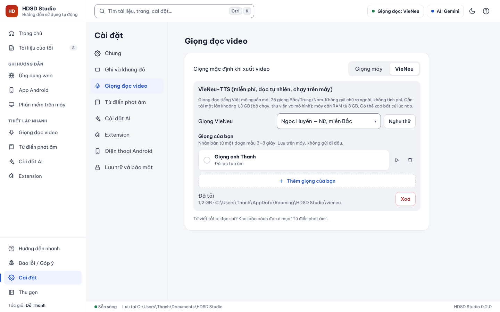
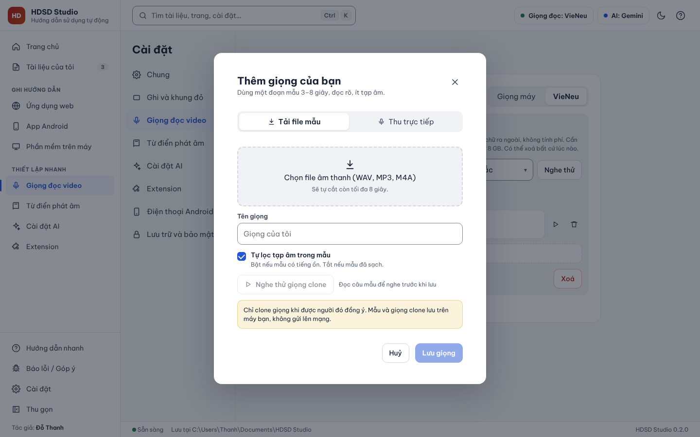
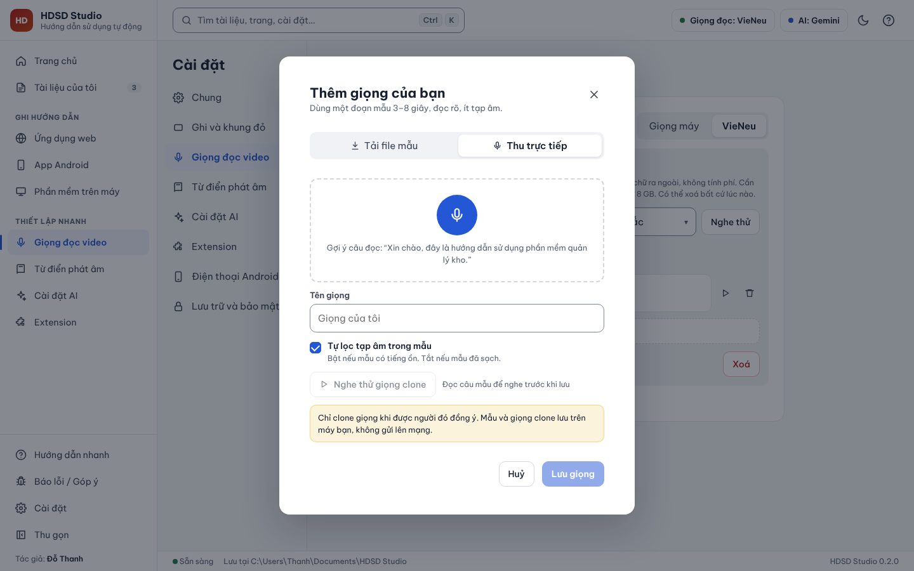
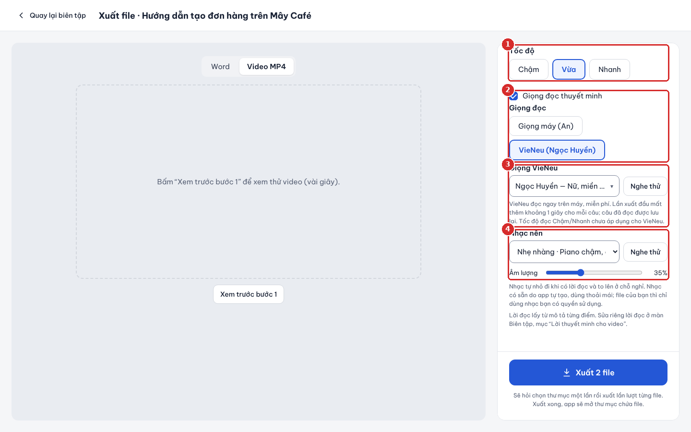
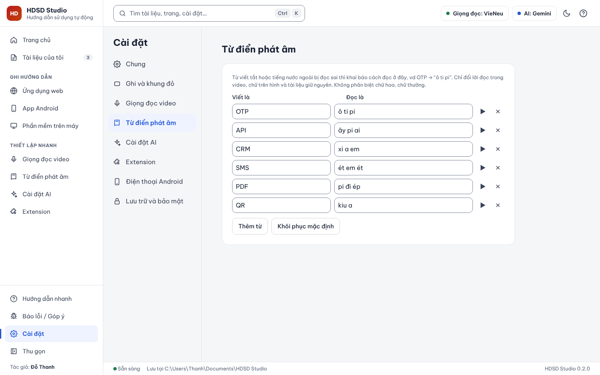

# 9. Giọng đọc và nhạc nền

[← Mục lục](README.md)

## 9.1. Các loại giọng đọc

| Giọng | Đặc điểm | Cần gì |
|---|---|---|
| **Giọng máy** | Giọng có sẵn của Windows / macOS. Đọc rõ nhưng hơi máy móc. Đọc được nhanh / chậm | Không cần tải |
| **Giọng VieNeu** | Giọng tiếng Việt **tự nhiên**, ngắt nghỉ như người đọc, **25 giọng Bắc / Trung / Nam**. Miễn phí, chạy ngay trên máy, **không gửi chữ ra ngoài** | Tải một lần ~1,3 GB, máy RAM từ 8 GB |
| **Giọng của bạn** | Giọng **nhân bản** từ một đoạn ghi âm 3–8 giây của bạn hoặc người khác (khi được đồng ý) | Đã tải VieNeu |

## 9.2. Tải giọng VieNeu (làm 1 lần)

1. Vào **Cài đặt › Giọng đọc video** (hoặc bấm chữ **Giọng đọc: …** trên cùng).
2. Bấm **Tải giọng đọc VieNeu (~1,3 GB)**.
3. Thanh tiến độ hiện từng phần đang tải. Có thể mất vài phút tuỳ tốc độ mạng. **Đừng tắt app** trong lúc tải.
4. Tải xong, app báo **"Đã tải xong giọng đọc VieNeu"**.

Sau khi tải:
- **Giọng mặc định khi xuất video**: chọn **VieNeu** (hoặc **Giọng máy**).
- **Giọng VieNeu**: chọn giọng trong danh sách, bấm **Nghe thử**. Ô chọn có **tìm kiếm**: gõ vài chữ (không cần dấu) để lọc, ví dụ gõ "nam" để thấy các giọng nam.
- Dòng **Đã tải** cho biết dung lượng và thư mục. Bấm **Xoá** để gỡ VieNeu khỏi máy (muốn dùng lại phải tải lại).

> Lần đầu sau khi mở app, giọng VieNeu cần khoảng **20–40 giây để khởi động**. Các lần đọc sau nhanh hơn nhiều.

## 9.3. Tạo giọng của riêng bạn

1. Ở **Cài đặt › Giọng đọc video**, mục **Giọng của bạn**, bấm **+ Thêm giọng của bạn**.

2. Chọn **nguồn mẫu giọng**:
   - **Tải file mẫu**: bấm **Chọn file âm thanh** (WAV, MP3, M4A). App tự cắt còn tối đa 8 giây.
   - **Thu trực tiếp**: bấm nút micro **Bắt đầu thu**, đọc to, rõ một câu, ví dụ: *"Xin chào, đây là hướng dẫn sử dụng phần mềm quản lý kho."* Bấm lại để **Dừng thu**. Lần đầu máy sẽ hỏi quyền dùng micro.

3. Bấm **Nghe lại mẫu** để kiểm tra. Mẫu nên dài **3–8 giây**, đọc rõ, **ít tạp âm**. Mẫu ngắn quá app sẽ báo "hơi ngắn". Chưa ưng thì **Chọn mẫu khác** / **Bỏ mẫu này**.
4. Đặt **Tên giọng**, ví dụ "Giọng anh Thanh".
5. **Tự lọc tạp âm trong mẫu**: bật nếu mẫu có tiếng ồn, tắt nếu mẫu đã sạch.
6. Bấm **Nghe thử giọng clone** để nghe giọng mới đọc một câu mẫu.
7. Ưng thì bấm **Lưu giọng**.

Giọng mới hiện trong danh sách **Giọng của bạn**:
- Bấm **vòng tròn** bên trái để **dùng giọng này**.
- Bấm **▶** để nghe thử, **thùng rác** để xoá.

Ở mọi ô chọn giọng, giọng của bạn nằm ở nhóm **Giọng của bạn**, phía trên nhóm **Giọng có sẵn**.

> **Chỉ tạo giọng khi được người đó đồng ý.** Mẫu và giọng tạo ra **chỉ lưu trên máy bạn**, không gửi lên mạng.

## 9.4. Chọn giọng cho từng video

Ở màn **Xuất file**, chọn **Video MP4**, mục **Giọng đọc thuyết minh**:

| Số | Mục | Dùng để |
|---|---|---|
| 1 | **Tốc độ** | **Chậm / Vừa / Nhanh** (hiện chỉ áp dụng cho giọng máy) |
| 2 | **Giọng đọc thuyết minh** | Bỏ tích nếu muốn video **không có tiếng đọc**. Chọn **Giọng máy** hoặc **VieNeu** |
| 3 | **Giọng VieNeu** | Chọn giọng (có tìm kiếm), bấm **Nghe thử** |
| 4 | **Nhạc nền** | Chọn nhạc, chỉnh âm lượng, xem [9.6](#96-nhạc-nền) |

Giọng chọn ở đây được lưu làm giọng mặc định cho lần sau.

## 9.5. Từ điển phát âm

Từ viết tắt hoặc tiếng nước ngoài bị đọc sai? Khai báo cách đọc ở **Cài đặt › Từ điển phát âm**.

| Viết là | Đọc là |
|---|---|
| OTP | ô ti pi |
| API | ây pi ai |
| PDF | pi đi ép |

- Bấm **Thêm từ** để thêm dòng mới. Gõ chữ như trong tài liệu ở cột **Viết là**, cách đọc ở cột **Đọc là**.
- Bấm **▶** để **nghe thử**, **×** để xoá dòng.
- **Khôi phục mặc định** để lấy lại danh sách ban đầu của app.
- Chỉ đổi **lời đọc** trong video, **chữ trên hình và tài liệu giữ nguyên**.
- Không phân biệt chữ hoa, chữ thường.

## 9.6. Nhạc nền

Ở màn **Xuất file**, chọn **Video MP4**, mục **Nhạc nền**:

| Lựa chọn | Mô tả |
|---|---|
| **Không có nhạc nền** | Video chỉ có giọng đọc |
| **Nhẹ nhàng** | Piano chậm, êm, hợp hướng dẫn dài |
| **Tươi sáng** | Vui, nhịp vừa, hợp giới thiệu tính năng |
| **Công nghệ** | Nhịp đều, hiện đại, hợp phần mềm |
| **Ấm áp** | Hợp âm dày, trang trọng, hợp trường học |
| **Tập trung** | Rất nhẹ, gần như không giai điệu |
| **Chọn file nhạc…** | Dùng file nhạc của bạn |

- Bấm **Nghe thử** để nghe, bấm **Dừng** để tắt.
- Kéo thanh **Âm lượng** (0–100%, mặc định 35%) để nhạc to hay nhỏ.
- Nhạc **tự nhỏ đi khi có lời đọc** và to lên ở chỗ nghỉ, **tự lặp** cho đủ dài video, có **mở dần** ở đầu và **nhỏ dần** ở cuối.
- Nhạc có sẵn do app tự tạo, **dùng thoải mái** không lo bản quyền. File của bạn thì chỉ dùng nhạc bạn có quyền sử dụng.

Nhạc nền và âm lượng được **lưu riêng cho từng tài liệu**.

> **Bản dịch sang ngôn ngữ khác** đọc bằng giọng máy của ngôn ngữ đó (VieNeu chỉ đọc tiếng Việt). Xem [13.7](13-dich-ngon-ngu.md#137-giọng-đọc-cho-bản-dịch).

[← Trang trước](08-video.md) · [Trang sau: Xuất file →](10-xuat-file.md)
