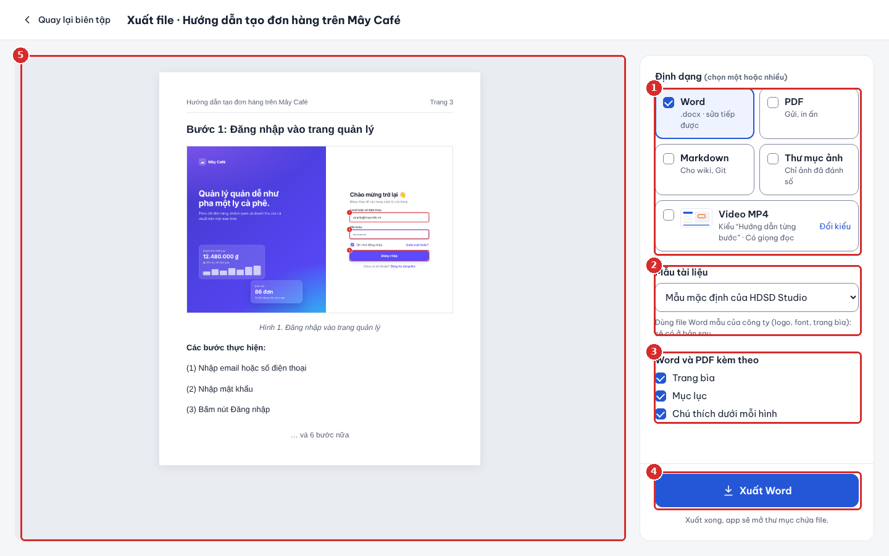

# 10. Xuất file

[← Mục lục](README.md)

Ở màn **Biên tập**, bấm **Xuất file** (góc trên phải).

| Số | Phần | Dùng để |
|---|---|---|
| 1 | **Định dạng** | Chọn **một hoặc nhiều** định dạng cùng lúc |
| 2 | **Mẫu tài liệu** | Mẫu trình bày Word / PDF. Hiện dùng **Mẫu mặc định của HDSD Studio**; dùng file Word mẫu của công ty (logo, font, trang bìa) sẽ có ở bản sau |
| 3 | **Word và PDF kèm theo** | Trang bìa, mục lục, chú thích dưới mỗi hình |
| 4 | **Nút Xuất** | Tên nút đổi theo lựa chọn: **Xuất Word**, **Xuất 2 file**… |
| 5 | **Xem trước** | Xem trước định dạng đang chọn. Chọn nhiều định dạng thì có thẻ để chuyển qua lại |

## 10.1. Chọn định dạng

| Định dạng | Ra file | Dùng khi |
|---|---|---|
| **Word** | `.docx` | Cần **sửa tiếp**, gửi người khác chỉnh, đưa vào hồ sơ |
| **PDF** | `.pdf` | **Gửi, in ấn**, đăng lên website |
| **Markdown** | `.md` + thư mục ảnh | Đưa lên **wiki, Git**, trang tài liệu nội bộ |
| **Thư mục ảnh** | Các file `.png` | Chỉ cần **ảnh đã đánh số** để chèn vào chỗ khác |
| **Video MP4** | `.mp4` | **Video hướng dẫn** có giọng đọc, nhạc nền (và phụ đề nếu bật trong Kiểu video) |

Tên file lấy theo **tên tài liệu**.

## 10.2. Word và PDF

Tuỳ chọn **Word và PDF kèm theo** (tích hoặc bỏ tích):

| Tuỳ chọn | Ý nghĩa |
|---|---|
| **Trang bìa** | Trang đầu có tên tài liệu |
| **Mục lục** | Danh sách các bước ở đầu tài liệu. **Bấm vào tên bước để nhảy tới đúng trang**. Mở file Word không bị hỏi "cập nhật trường" |
| **Chú thích dưới mỗi hình** | Dòng "Hình n. …" dưới mỗi ảnh |

Mỗi bước trong tài liệu gồm: **tiêu đề bước**, **ảnh có khung đỏ và số**, mục **"Các bước thực hiện"** liệt kê mô tả từng điểm theo số, và **ghi chú** nếu có.

## 10.3. Video MP4

Tích **Video MP4**. Phần tuỳ chọn video hiện ra:

- Dòng **Kiểu "…"**: kiểu và khổ video lấy theo **Kiểu video** ở màn Biên tập. Bấm **Đổi kiểu** để đổi (xem [trang 8](08-video.md)).
- **Chất lượng**: **Cao** (nét nhất, khoảng 46 MB mỗi phút), **Vừa** (chữ vẫn nét, khoảng 23 MB mỗi phút, nên dùng), **Nhẹ** (gửi nhanh qua Zalo, email, khoảng 12 MB mỗi phút). App nhớ lựa chọn cho lần sau.
- **Tốc độ**, **Giọng đọc thuyết minh**, **Giọng VieNeu**, **Nhạc nền**, **Âm lượng**: xem [Giọng đọc và nhạc nền](09-giong-doc.md#94-chọn-giọng-cho-từng-video).
- Ô xem trước bên trái: bấm **Xem trước bước 1** để xem thử vài giây **có giọng đọc** trước khi xuất cả video.

Khi xuất video:
- App hiện tiến độ ("Đang vẽ ảnh 3/7…", "Đang đọc…", "Đang lưu file…"). Bấm **Huỷ** để dừng bất cứ lúc nào.
- Lần xuất đầu với giọng VieNeu mất thêm khoảng **1 giây cho mỗi câu**. Câu đã đọc được **lưu lại**, lần sau xuất nhanh hơn.
- Video ra khổ **ngang 16:9** (1920×1080) hoặc **dọc 9:16** (với kiểu Cận cảnh từng điểm).
- Lời đọc lấy từ mô tả từng điểm. Muốn sửa riêng lời đọc: ở màn Biên tập, tab **Video** của từng bước, hoặc **Bảng lời đọc** (xem [7.3](07-ai.md#73-bảng-lời-đọc-cả-video)).

## 10.4. Bấm Xuất

1. Bấm nút **Xuất** ở cuối cột phải.
2. Chọn **nơi lưu**:
   - Một định dạng: chọn nơi lưu và tên file.
   - Nhiều định dạng: app **hỏi chọn thư mục một lần** rồi xuất lần lượt từng file.
3. Xuất xong, app báo **"Đã xuất xong"** (hoặc **"Đã xuất n file vào …"**) và **tự mở thư mục chứa file**. Có nút **Mở thư mục chứa file** để mở lại.

Bấm **Quay lại biên tập** (góc trên trái) để sửa tiếp.

## 10.5. Mẹo

- Muốn **video và tài liệu khớp nhau**: xuất cả **Word + Video MP4** trong một lần.
- Đăng video lên **YouTube / Zalo / Facebook**: dùng kiểu **Hướng dẫn từng bước** (ngang). Đăng **TikTok / Reels**: dùng kiểu **Cận cảnh từng điểm**, khổ **Dọc 9:16**.
- File Word mở ra **sửa tiếp được** như mọi file Word: đổi chữ, thêm trang, đổi font.

[← Trang trước](09-giong-doc.md) · [Trang sau: Cài đặt của app →](11-cai-dat-app.md)
