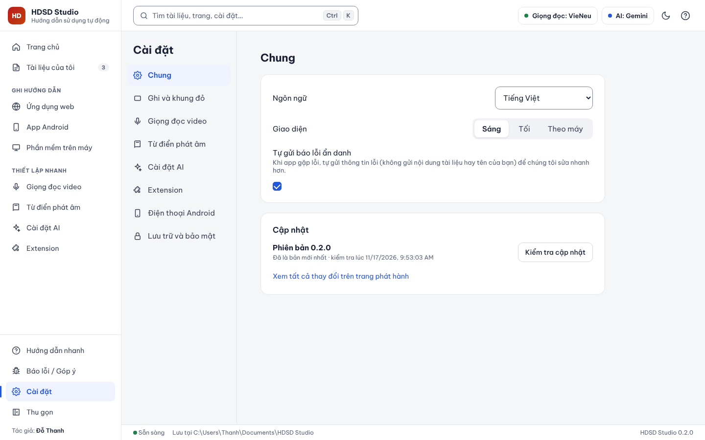
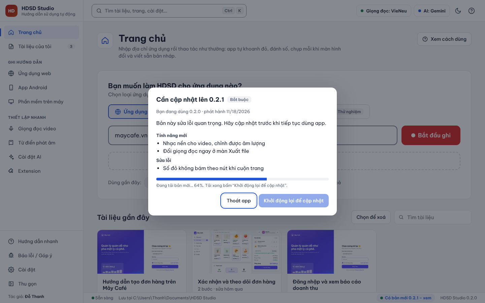
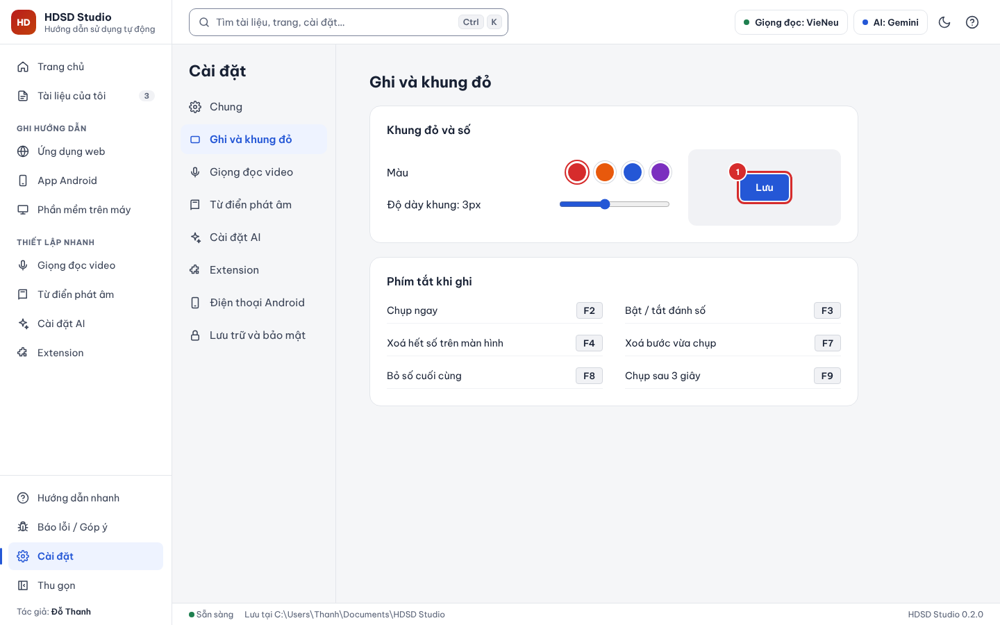
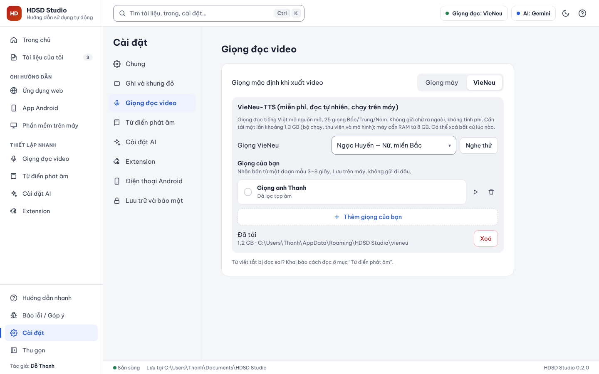
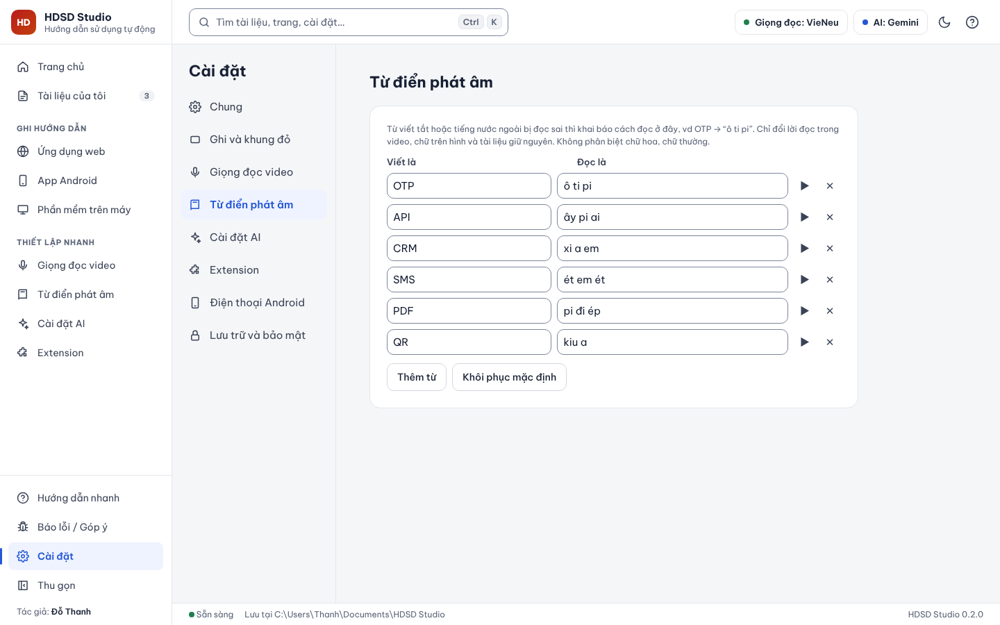
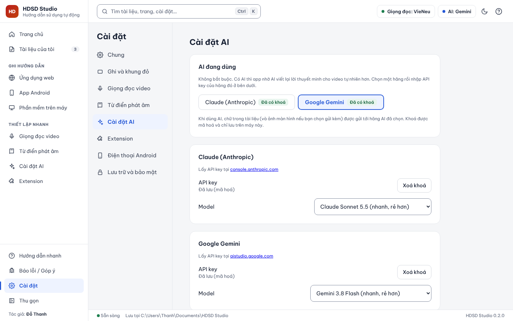
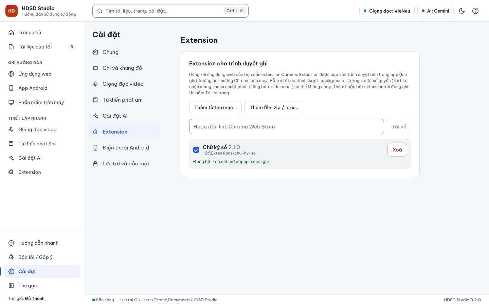
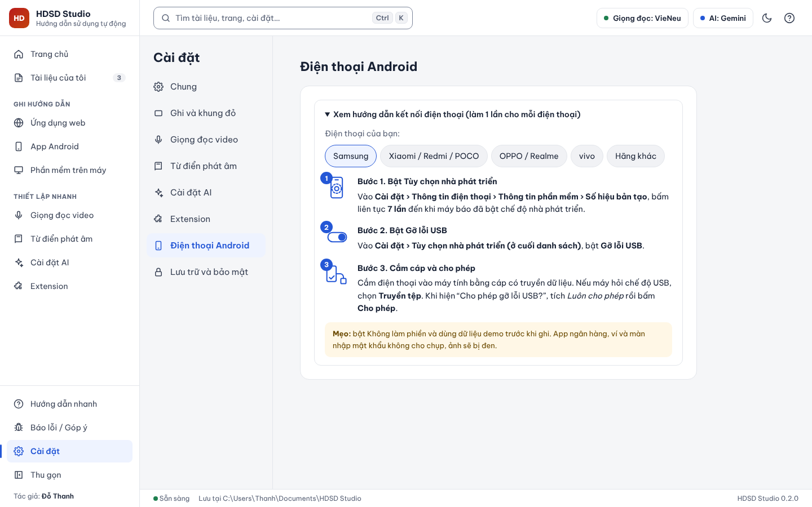
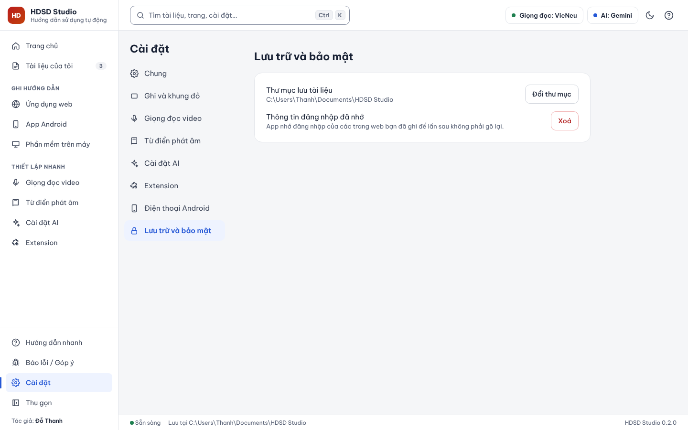

# 11. Cài đặt của app

[← Mục lục](README.md)

Bấm **Cài đặt** ở thanh bên trái. Cột trái có 8 mục, bấm từng mục để xem (hoặc dùng phím mũi tên lên/xuống). Mọi thay đổi **tự lưu ngay**, không cần bấm Lưu.

| Mục | Dùng để |
|---|---|
| [Chung](#111-chung) | Ngôn ngữ, giao diện sáng/tối, báo lỗi ẩn danh, cập nhật |
| [Ghi và khung đỏ](#112-ghi-và-khung-đỏ) | Màu và độ dày khung đỏ, phím tắt khi ghi |
| [Giọng đọc video](#113-giọng-đọc-video) | Giọng mặc định, tải giọng VieNeu, giọng của bạn |
| [Từ điển phát âm](#114-từ-điển-phát-âm) | Dạy app đọc đúng từ viết tắt |
| [Cài đặt AI](#115-cài-đặt-ai) | Chọn hãng AI, nhập API key, chọn model |
| [Extension](#116-extension) | Thêm extension Chrome cho trình duyệt ghi |
| [Điện thoại Android](#117-điện-thoại-android) | Hướng dẫn kết nối điện thoại theo hãng |
| [Lưu trữ và bảo mật](#118-lưu-trữ-và-bảo-mật) | Thư mục lưu tài liệu, xoá đăng nhập đã nhớ |

## 11.1. Chung

| Mục | Ý nghĩa |
|---|---|
| **Ngôn ngữ** | **Tiếng Việt** hoặc **English**. Đổi là giao diện đổi ngay |
| **Giao diện** | **Sáng**, **Tối**, hoặc **Theo máy** (tự đổi theo chế độ sáng/tối của Windows, macOS) |
| **Tự gửi báo lỗi ẩn danh** | Tích thì khi app gặp lỗi, app tự gửi thông tin lỗi để tác giả sửa nhanh hơn. **Không gửi nội dung tài liệu hay tên của bạn.** Bỏ tích nếu không muốn |

### Cập nhật

- Dòng **Phiên bản** cho biết bản bạn đang dùng và lần kiểm tra gần nhất.
- Bấm **Kiểm tra cập nhật** để kiểm tra ngay. App cũng **tự kiểm tra** sau khi mở khoảng 10 giây và định kỳ trong lúc dùng.
- Có bản mới: app hiện **danh sách thay đổi** và tự tải về (bạn vẫn dùng app bình thường). Tải xong bấm **Khởi động lại để cập nhật**, hoặc **Để sau**: bản mới sẽ tự cài khi bạn tắt app.
- Bản đánh dấu **Bắt buộc** là bản sửa lỗi quan trọng, cần cập nhật trước khi dùng tiếp.
- **Xem tất cả thay đổi trên trang phát hành**: mở trang GitHub có lịch sử các bản.
- Trên **macOS**: bấm **Tải bản mới (.dmg)**, mở file vừa tải, kéo HDSD Studio vào **Applications** và chọn **Thay thế**. Tài liệu và cài đặt được giữ nguyên.

## 11.2. Ghi và khung đỏ

### Khung đỏ và số

| Mục | Ý nghĩa |
|---|---|
| **Màu** | 4 màu: **Đỏ** (mặc định), **Cam**, **Xanh dương**, **Tím**. Đổi màu khi trang web của bạn cũng nhiều màu đỏ, khung đỏ khó nhìn |
| **Độ dày khung** | Kéo thanh trượt từ **1px đến 6px** |
| **Xem trước** | Ô bên phải là nút "Lưu" mẫu có khung và số 1, đổi theo ngay khi bạn chỉnh |

Màu và độ dày áp dụng cho **các lần chụp mới**. Ảnh đã chụp vẫn giữ như cũ, nhưng bạn có thể chỉnh từng khung ở màn Biên tập.

### Phím tắt khi ghi

| Phím | Việc |
|---|---|
| **F2** | Chụp ngay |
| **F3** | Bật / tắt đánh số |
| **F4** | Xoá hết số trên màn hình |
| **F7** | Xoá bước vừa chụp |
| **F8** | Bỏ số cuối cùng |
| **F9** | Chụp sau 3 giây (để kịp mở menu, di chuột…) |

Trên **MacBook**, nếu phím F2 không chạy, **giữ phím fn rồi bấm F2**.

## 11.3. Giọng đọc video

| Mục | Ý nghĩa |
|---|---|
| **Giọng mặc định khi xuất video** | **Giọng máy** (có sẵn, không cần tải) hoặc **VieNeu** (đọc tự nhiên hơn). Mỗi lần xuất vẫn đổi được |
| **VieNeu-TTS** | Giọng đọc tiếng Việt miễn phí, **25 giọng Bắc / Trung / Nam**, chạy ngay trên máy, không gửi chữ ra ngoài |
| **Tải giọng đọc VieNeu (~1,3 GB)** | Tải một lần. Có thể mất vài phút, **đừng tắt app** khi đang tải. Máy cần **RAM từ 8 GB** |
| **Giọng VieNeu + Nghe thử** | Chọn giọng trong danh sách (vd *Ngọc Huyền — Nữ, miền Bắc*) rồi bấm **Nghe thử** |
| **Giọng của bạn** | Nhân bản từ một đoạn mẫu **3–8 giây**, lưu trên máy, không gửi đi đâu. Bấm **+ Thêm giọng của bạn** (xem [9.3](09-giong-doc.md#93-tạo-giọng-của-riêng-bạn)). Mỗi giọng có nút **▶** nghe thử và **thùng rác** để xoá |
| **Đã tải … Xoá** | Dòng cuối cho biết dung lượng và nơi lưu VieNeu. Bấm **Xoá** để gỡ khỏi máy. Muốn dùng lại phải tải lại ~1,3 GB |

Lần đầu sau khi mở app, giọng VieNeu cần khoảng **20–40 giây để khởi động**. Chi tiết: [Giọng đọc và nhạc nền](09-giong-doc.md).

## 11.4. Từ điển phát âm

Dùng khi từ viết tắt hoặc tiếng nước ngoài bị đọc sai.

1. Bấm **Thêm từ** để có dòng mới.
2. Cột **Viết là**: gõ chữ như trên màn hình, vd `OTP`.
3. Cột **Đọc là**: gõ cách đọc, vd `ô ti pi`.
4. Bấm **▶** ở cuối dòng để nghe thử app đọc. Bấm **×** để bỏ dòng.

- Chỉ đổi **lời đọc trong video**. Chữ trên hình và trong tài liệu **giữ nguyên**.
- **Không phân biệt** chữ hoa, chữ thường.
- App có sẵn một số từ hay gặp. Bấm **Khôi phục mặc định** để đưa danh sách về như ban đầu.

## 11.5. Cài đặt AI

AI **không bắt buộc**. Có AI thì app nhờ AI **viết lại lời thuyết minh và các bước** tự nhiên hơn (xem [trang 7](07-ai.md)).

1. Ở **AI đang dùng**, chọn hãng: **Claude (Anthropic)** hoặc **Google Gemini**.
2. Ở thẻ của hãng đó, bấm link **Lấy API key tại…** để vào trang của hãng, tạo khoá.
3. Dán khoá vào ô rồi bấm **Lưu**. Thấy **Đã lưu (mã hoá)** là xong.
4. Chọn **model**:

| Hãng | Model gợi ý |
|---|---|
| Claude | **Opus** (viết hay nhất), **Sonnet** (nhanh, rẻ hơn), **Haiku** (nhanh nhất, rẻ nhất) |
| Gemini | Bản **viết hay nhất**, bản **Flash** (nhanh, rẻ hơn), bản **Flash-Lite** (nhanh nhất, rẻ nhất). Sau khi lưu khoá, app tải thêm **các model khác của tài khoản**, hoặc chọn **Nhập tên model khác…** |

- **Bảo mật:** khoá được **mã hoá và chỉ lưu trên máy này**. Khi dùng AI, chữ trong tài liệu (và ảnh màn hình nếu bạn chọn gửi kèm) được gửi tới hãng AI đã chọn.
- Bấm **Xoá khoá** để gỡ khoá khỏi máy.
- Phí AI do hãng AI tính trực tiếp trên tài khoản của bạn, HDSD Studio không thu thêm.

## 11.6. Extension

Dùng khi trang web bạn ghi **cần extension Chrome** mới chạy được (vd extension chữ ký số, extension đăng nhập của công ty). Extension chỉ nạp vào **trình duyệt bên trong app**, không ảnh hưởng Chrome của máy.

Có 3 cách thêm:

| Cách | Làm thế nào |
|---|---|
| **Link Chrome Web Store** | Dán link trang extension (`chromewebstore.google.com/...`) rồi bấm **Tải về** |
| **Thêm file .zip / .crx…** | Chọn file extension đã tải sẵn |
| **Thêm từ thư mục…** | Chọn thư mục extension đã giải nén |

Mỗi extension trong danh sách có:
- Ô tích để **bật / tắt**. Đang bật thì hiện chữ xanh **Đang bật**.
- **Nạp lại** (với extension thêm từ thư mục): bấm sau khi bạn sửa file trong thư mục đó.
- **Xoá**: bỏ extension khỏi app. Thư mục gốc của bạn được giữ nguyên.

Lưu ý:
- Thêm hoặc bật extension **khi đang ghi** thì bấm **Tải lại trang** ở màn ghi.
- Extension có popup thì có **nút mở popup ở màn ghi**.
- Hỗ trợ tốt phần lớn extension. Một số quyền đặc biệt (tải file, chặn mạng, menu chuột phải, thông báo, side panel) có thể không chạy.

## 11.7. Điện thoại Android

Hướng dẫn chuẩn bị điện thoại để ghi, **làm 1 lần cho mỗi điện thoại**. Chọn **Hãng điện thoại** (Samsung, Xiaomi / Redmi / POCO, OPPO / Realme, vivo, Hãng khác) để thấy đúng đường dẫn trong máy.

| Hãng | Bấm 7 lần vào | Tùy chọn nhà phát triển ở |
|---|---|---|
| Samsung | Cài đặt › Thông tin điện thoại › Thông tin phần mềm › **Số hiệu bản tạo** | Cài đặt › Tùy chọn nhà phát triển (ở cuối danh sách) |
| Xiaomi / Redmi / POCO | Cài đặt › Giới thiệu điện thoại › **Phiên bản HyperOS (hoặc MIUI)** | Cài đặt › Cài đặt bổ sung › Tùy chọn nhà phát triển |
| OPPO / Realme | Cài đặt › Giới thiệu máy › Phiên bản › **Số bản dựng** | Cài đặt › Cài đặt bổ sung › Tùy chọn nhà phát triển |
| vivo | Cài đặt › Hệ thống › Giới thiệu › Thông tin phiên bản phần mềm › **Phiên bản phần mềm** | Cài đặt › Hệ thống › Tùy chọn nhà phát triển |
| Hãng khác | Cài đặt › Giới thiệu về điện thoại › **Số bản dựng** | Cài đặt › Hệ thống › Tùy chọn nhà phát triển |

Sau đó bật **Gỡ lỗi USB**, cắm cáp, chọn **Truyền tệp**, và khi hiện "Cho phép gỡ lỗi USB?" thì tích **Luôn cho phép** rồi bấm **Cho phép**.

- **Xiaomi:** bật thêm "**Gỡ lỗi USB (Cài đặt bảo mật)**" để bấm được bằng chuột. Máy có thể đòi đăng nhập tài khoản Mi.
- **OPPO / Realme:** nếu bấm bằng chuột không ăn, bật "**Tắt giám sát quyền**".

Chi tiết: [Ghi điện thoại Android](05-ghi-android.md).

## 11.8. Lưu trữ và bảo mật

| Mục | Ý nghĩa |
|---|---|
| **Thư mục lưu tài liệu** | Nơi app lưu các tài liệu bạn ghi (dòng chữ nhỏ là đường dẫn hiện tại). Bấm **Đổi thư mục** để chọn nơi khác, vd ổ D hoặc thư mục OneDrive / Google Drive để tự sao lưu |
| **Thông tin đăng nhập đã nhớ** | App nhớ đăng nhập các trang web bạn đã ghi để lần sau không phải gõ lại. Bấm **Xoá** để quên hết (vd trước khi đưa máy cho người khác, hoặc muốn ghi bằng tài khoản khác) |

[← Trang trước](10-xuat-file.md) · [Trang sau: Báo lỗi và hỏi đáp →](12-bao-loi-hoi-dap.md)
