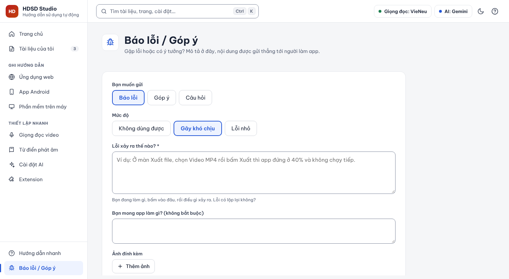

# 12. Báo lỗi và hỏi đáp

[← Mục lục](README.md)

## 12.1. Gửi báo lỗi, góp ý ngay trong app

Bấm **Báo lỗi / Góp ý** ở góc dưới thanh bên trái. Nội dung được **gửi thẳng tới người làm app**.

1. **Bạn muốn gửi**: chọn **Báo lỗi**, **Góp ý** hoặc **Câu hỏi**. Ô bên dưới đổi tên theo lựa chọn (Lỗi xảy ra thế nào? / Ý tưởng của bạn / Câu hỏi của bạn).
2. **Mức độ** (khi báo lỗi):
   - **Không dùng được**: app đứng, không làm tiếp được.
   - **Gây khó chịu**: vẫn làm được nhưng mất công.
   - **Lỗi nhỏ**: sai chữ, lệch giao diện…
3. **Mô tả** (bắt buộc): bạn đang làm gì, bấm vào đâu, rồi điều gì xảy ra, lỗi có lặp lại không. Viết càng cụ thể càng tốt.
   > Ví dụ: *Ở màn Xuất file, chọn Video MP4 rồi bấm Xuất thì app đứng ở 40% và không chạy tiếp.*
4. **Bạn mong app làm gì?** (không bắt buộc).
5. **Ảnh đính kèm**:
   - App tự chụp sẵn **màn hình lúc bạn mở trang báo lỗi**. Bỏ tích **Gửi kèm ảnh màn hình vừa rồi** nếu không muốn gửi.
   - Bấm **Thêm ảnh** để thêm ảnh khác. Chỉ nhận **PNG hoặc JPG**, mỗi ảnh **dưới 10 MB**, tổng cộng **tối đa 5 ảnh**.
6. **Liên hệ của bạn** (không bắt buộc): tên, số điện thoại hoặc email để tác giả hỏi thêm khi cần.
7. Bấm **Gửi báo lỗi**. Thấy "Đã gửi. Cảm ơn bạn!" là xong.

App tự gửi kèm **phiên bản app, loại máy, màn hình đang mở và các lỗi gần đây** để tác giả dễ tìm nguyên nhân. **Không gửi nội dung tài liệu** của bạn.

Không gửi được (máy không có mạng…): bấm **Sao chép nội dung** rồi dán vào Zalo hoặc email để gửi.

## 12.2. Hỏi đáp

### Cài đặt và cập nhật

**Windows hiện hộp xanh "Windows đã bảo vệ PC của bạn" khi cài.**
Bấm chữ **Thông tin bổ sung** rồi bấm **Vẫn chạy** (bản tiếng Anh: **More info** › **Run anyway**). Đây là cảnh báo chung cho phần mềm mới, không phải lỗi. Xem [1.3](01-cai-dat.md#13-cài-trên-windows).

**macOS báo "không thể mở vì không xác minh được nhà phát triển".**
Xem [1.4](01-cai-dat.md#14-cài-trên-macos).

**Cập nhật có mất tài liệu không?**
Không. Tài liệu và cài đặt được giữ nguyên.

**Làm sao biết đang dùng bản nào?**
Góc dưới phải màn hình, hoặc **Cài đặt › Chung › Cập nhật**.

### Khi ghi

**Bấm vào trang web mà không thấy khung đỏ, số.**
- Kiểm tra **đánh số đang bật** (phím **F3**).
- Trang vừa tải xong: chờ 1–2 giây rồi bấm lại.
- Muốn chụp màn hình mà không đánh số: bấm **F2**.

**Muốn chụp menu xổ xuống, ô gợi ý, tooltip (bấm ra chỗ khác là mất).**
Bấm **F9** (chụp sau 3 giây), rồi mở menu trong 3 giây đó.

**Chụp nhầm một bước.**
Bấm **F7** để xoá bước vừa chụp. Đánh số nhầm thì **F8** bỏ số cuối cùng.

**Trang web bắt đăng nhập mỗi lần ghi.**
App tự nhớ đăng nhập. Nếu vẫn bị hỏi, có thể trang web tự đăng xuất sau một thời gian. Muốn quên hết đăng nhập: **Cài đặt › Lưu trữ và bảo mật › Thông tin đăng nhập đã nhớ › Xoá**.

**Trang web cần extension (chữ ký số, đăng nhập…) mới chạy.**
Thêm extension ở **Cài đặt › Extension** ([11.6](11-cai-dat-app.md#116-extension)), rồi bấm **Tải lại trang** ở màn ghi.

**Trên MacBook, phím F2 không chạy.**
Giữ **fn** rồi bấm **F2**.

**Ghi phần mềm trên máy thì app không thấy cửa sổ / không bấm được.**
- Windows: phần mềm đang chạy bằng **quyền Admin**. Xem [4.3](04-ghi-phan-mem.md#43-trên-windows-phần-mềm-chạy-quyền-admin).
- macOS: chưa cấp quyền cho app. Xem [4.2](04-ghi-phan-mem.md#42-trên-macos-cấp-2-quyền-làm-1-lần).

**App không nhận điện thoại Android.**
Xem [5.6. Không nhận điện thoại?](05-ghi-android.md#56-không-nhận-điện-thoại).

### Biên tập

**Ảnh có thông tin nhạy cảm (số tài khoản, số điện thoại…).**
Dùng **Làm mờ** ở màn Biên tập. Xem [6. Biên tập](06-bien-tap.md).

**Muốn ghi thêm bước vào tài liệu đã có.**
Ở màn Biên tập, bấm **Ghi thêm bước**. Bước mới được thêm vào cuối tài liệu.

**Lỡ xoá hoặc sửa sai.**
Bấm **Ctrl+Z** (macOS: **⌘+Z**) để hoàn tác.

### AI

**Nút viết lời bằng AI không bấm được.**
Chưa có API key cho hãng AI đang chọn. Vào **Cài đặt › Cài đặt AI** ([11.5](11-cai-dat-app.md#115-cài-đặt-ai)).

**AI có đọc được dữ liệu của tôi không?**
Chỉ khi bạn bấm dùng AI, chữ trong tài liệu (và ảnh nếu bạn chọn gửi kèm) mới được gửi tới hãng AI bạn chọn. Không dùng AI thì không có gì gửi đi.

**Không có AI có làm được video không?**
Có. App vẫn tự tạo lời đọc từ mô tả các bước. AI chỉ giúp lời đọc tự nhiên hơn.

### Video và giọng đọc

**Giọng đọc sai từ viết tắt (OTP, API, PDF…).**
Khai báo ở **Từ điển phát âm** ([11.4](11-cai-dat-app.md#114-từ-điển-phát-âm)).

**Xuất video lần đầu rất lâu.**
Giọng VieNeu cần 20–40 giây khởi động sau khi mở app và khoảng 1 giây cho mỗi câu. Lần sau nhanh hơn vì câu đã đọc được lưu lại.

**Không tải được giọng VieNeu.**
Cần mạng ổn định và khoảng **1,3 GB** trống, máy **RAM từ 8 GB**. Tải lỗi thì bấm **Thử lại**. Máy không đủ thì dùng **Giọng máy**.

**Muốn video dọc để đăng TikTok / Reels.**
Chọn kiểu **Cận cảnh từng điểm**, khổ **Dọc 9:16**. Xem [8.1](08-video.md#81-chọn-kiểu-video).

**Muốn tắt nhạc nền.**
Ở màn Xuất file, phần **Nhạc nền** chọn **Không có nhạc nền**.

### Dịch sang ngôn ngữ khác

**Bấm "Dịch sang ngôn ngữ khác" mà AI chưa dịch?**
Nút đó chỉ mở hộp thoại. Chọn ngôn ngữ rồi bấm **Bắt đầu dịch**. Xem [13.2](13-dich-ngon-ngu.md#132-dịch-tài-liệu).

**Báo "Chưa có API key"?**
Vào **Cài đặt › Cài đặt AI** nhập khoá của AI đang chọn (Claude hoặc Gemini). Xem [7.1](07-ai.md#71-cài-ai-làm-1-lần).

**Đang dịch nhiều ngôn ngữ thì bị lỗi.**
Các ngôn ngữ đã xong vẫn được giữ. Mở lại hộp thoại, bấm **Bắt đầu dịch** để dịch tiếp phần còn lại.

**Tên nút trong bản dịch vẫn là tiếng Việt.**
Đúng như thiết kế: chữ trên giao diện phần mềm được giữ nguyên để người xem tìm đúng nút trên ảnh chụp.

**Video tiếng nước ngoài báo "Máy chưa có giọng đọc…".**
Tải giọng của ngôn ngữ đó trên máy, xem [13.7](13-dich-ngon-ngu.md#137-giọng-đọc-cho-bản-dịch). Riêng **tiếng Lào và Khmer** chưa có giọng: tắt Giọng đọc khi xuất.

### Tài liệu và file

**Tài liệu được lưu ở đâu?**
Đường dẫn hiện ở thanh dưới cùng ("Lưu tại …"). Đổi ở **Cài đặt › Lưu trữ và bảo mật › Đổi thư mục**.

**Chuyển tài liệu sang máy khác thế nào?**
Chép cả thư mục lưu tài liệu sang máy mới, rồi trên máy mới chọn **Đổi thư mục** tới thư mục đó.

[← Trang trước](11-cai-dat-app.md) · [Trang sau: Dịch sang ngôn ngữ khác →](13-dich-ngon-ngu.md)
