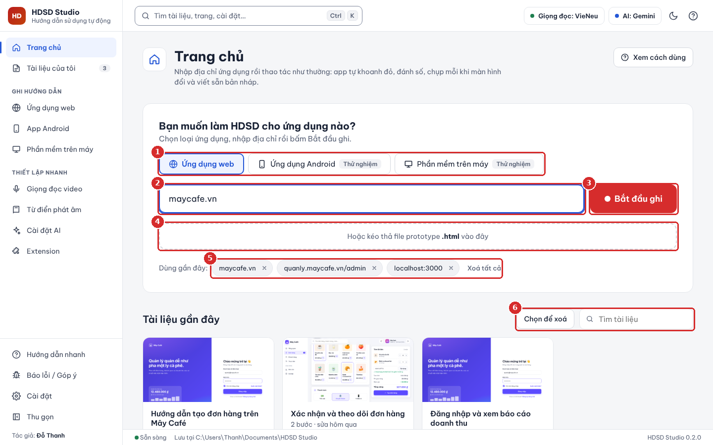

# Hướng dẫn sử dụng HDSD Studio

HDSD Studio giúp bạn làm **tài liệu và video hướng dẫn sử dụng phần mềm** chỉ bằng cách thao tác một lần. Bạn dùng phần mềm như bình thường, app tự **khoanh đỏ, đánh số, chụp màn hình** (kể cả khi mở hộp thoại) và **viết sẵn câu mô tả**. Sau đó AI viết lời đọc, và app dựng thành **video có giọng đọc tiếng Việt, phụ đề và nhạc nền**, hoặc xuất ra **Word, PDF, Markdown**. AI còn **dịch cả tài liệu và video sang 11 ngôn ngữ** khác.

## Bắt đầu nhanh trong 5 phút

1. **Cài app**: tải và cài theo [trang 1](01-cai-dat.md).
2. **Ghi**: ở Trang chủ, nhập địa chỉ trang web cần làm hướng dẫn, bấm **Bắt đầu ghi**. Thao tác như bình thường, bấm đến đâu app khoanh đỏ đến đó. Xong bấm **Kết thúc**. Xem [trang 3](03-ghi-web.md).
3. **Chỉnh**: ở màn Biên tập, sửa tên bước và câu mô tả, làm mờ thông tin nhạy cảm. Xem [trang 6](06-bien-tap.md).
4. **Nhờ AI viết lời đọc** (không bắt buộc): bấm **Viết lời đọc bằng AI**. Xem [trang 7](07-ai.md).
5. **Dịch** (không bắt buộc): ở cột trái, mục **Ngôn ngữ**, bấm **Dịch sang ngôn ngữ khác**, chọn ngôn ngữ, bấm **Bắt đầu dịch**. Xem [trang 13](13-dich-ngon-ngu.md).
6. **Xuất**: bấm **Xuất file**, chọn **Word**, **PDF** hoặc **Video MP4**, chọn ngôn ngữ, giọng đọc và nhạc nền, bấm **Xuất**. Xem [trang 10](10-xuat-file.md).

## Mục lục

| # | Trang | Bạn sẽ biết |
|---|---|---|
| 1 | [Cài đặt và cập nhật](01-cai-dat.md) | Tải đúng file, cài trên Windows và macOS, cập nhật bản mới |
| 2 | [Làm quen giao diện](02-lam-quen.md) | Trang chủ, thanh bên, thanh trên cùng, tài liệu của tôi, tìm nhanh |
| 3 | [Ghi ứng dụng web](03-ghi-web.md) | Màn ghi, từng nút và phím tắt, **tự chụp khi mở hộp thoại**, trang dài, menu rê chuột, vùng chụp, extension |
| 4 | [Ghi phần mềm trên máy](04-ghi-phan-mem.md) | Chọn cửa sổ, thanh công cụ nổi, quyền macOS, quyền Admin trên Windows |
| 5 | [Ghi ứng dụng Android](05-ghi-android.md) | Bật gỡ lỗi USB theo từng hãng, kết nối, điều khiển điện thoại bằng chuột |
| 6 | [Biên tập tài liệu](06-bien-tap.md) | Sửa câu chữ, khung đỏ, làm mờ, cắt ảnh, thêm ảnh, sắp xếp, tách và gộp bước |
| 7 | [AI viết lời đọc](07-ai.md) | Cài Gemini hoặc Claude, viết lời đọc tự động, bảng lời đọc cả video |
| 8 | [Làm video hướng dẫn](08-video.md) | 3 kiểu video, mở đầu, kết thúc, bố cục từng bước, cảnh lưu ý |
| 9 | [Giọng đọc và nhạc nền](09-giong-doc.md) | Giọng VieNeu, tạo giọng của chính bạn, từ điển phát âm, nhạc nền |
| 10 | [Xuất file](10-xuat-file.md) | Word, PDF, Markdown, thư mục ảnh, video MP4 |
| 11 | [Cài đặt của app](11-cai-dat-app.md) | Giải thích từng mục trong Cài đặt |
| 12 | [Báo lỗi và câu hỏi thường gặp](12-bao-loi-hoi-dap.md) | Gửi lỗi cho tác giả, xử lý các lỗi hay gặp |
| 13 | [Dịch sang ngôn ngữ khác](13-dich-ngon-ngu.md) | AI dịch tài liệu và lời đọc sang 11 ngôn ngữ, duyệt bản dịch, xuất từng ngôn ngữ, giọng đọc |

## Bảng phím tắt

| Phím | Khi nào | Việc |
|---|---|---|
| **F2** | Khi ghi | Chụp ngay màn hình hiện tại thành một bước |
| **F3** | Khi ghi | Bật / tắt đánh số |
| **F4** | Khi ghi | Xoá hết số trên màn hình hiện tại |
| **F6** | Khi ghi web | Bật / tắt vùng chụp |
| **F7** | Khi ghi | Xoá bước vừa chụp |
| **F8** | Khi ghi | Bỏ số cuối cùng |
| **F9** | Khi ghi | Chụp sau 3 giây (cho menu chỉ hiện khi rê chuột) |
| **Ctrl + K** (⌘ K trên Mac) | Mọi lúc | Mở ô tìm nhanh |
| **Ctrl + Z** | Màn Biên tập | Hoàn tác |
| **Ctrl + Y** hoặc **Ctrl + Shift + Z** | Màn Biên tập | Làm lại |
| **N**, **mũi tên**, **Alt + mũi tên**, **Delete** | Màn Biên tập | Chọn, di chuyển, đổi cỡ, xoá khung trên ảnh |

Trên MacBook, nếu F2–F9 không chạy, giữ phím **fn** rồi bấm.

> Ảnh minh hoạ trong hướng dẫn dùng trang web mẫu **Mây Café** (dữ liệu giả) đi kèm app.
